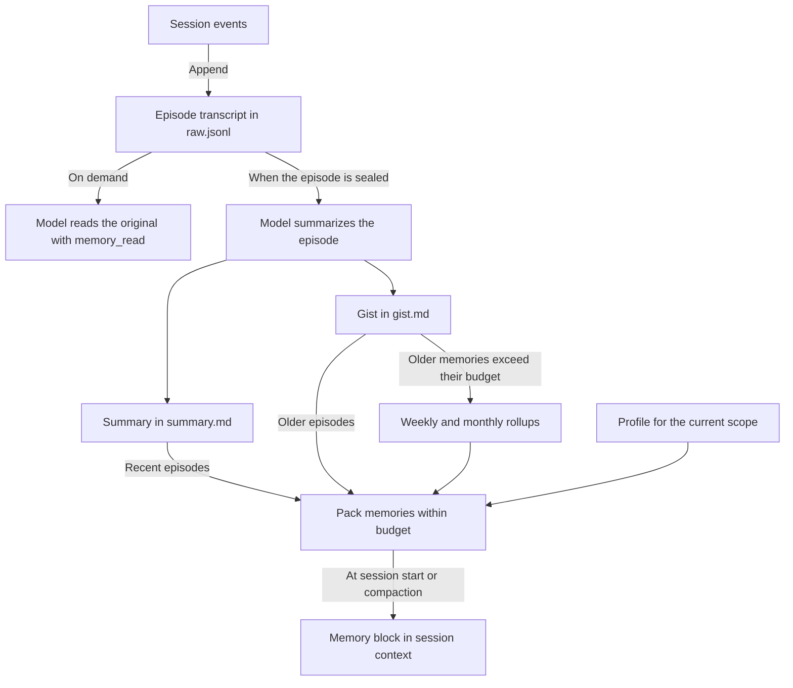

# Memory Cloud: usage and configuration

[Back to the project overview](../README.en.md) · [中文手册](reference.md)

Welcome back to a new session. If you've used this scope before, you can pick up where the last conversation left off. Memory Cloud gives [DeepSeek Harness](https://github.com/deepseek-ai/deepseek-harness) (DSH) brain-like layers of long-term memory and can serve as its context compaction engine. It was designed for long-running companions such as 大肥鱼 (“Big Fat Fish”), a persistent agent living in a home session and in chat rooms.

Memory Cloud appends the session events it captures to local files. It never rewrites or deletes the originals. Each **episode** gets two lengths of recollection. A one-line **gist** says that something happened. A fuller **summary** says how it happened. For someone's exact words, the model can search for the episode with `memory_search` and page through its transcript with `memory_read`.

At session start and after compaction, a `<memory-cloud>` block brings the profile, distant gists and recent summaries into context. Choose **Take over compaction** and the block itself becomes the DSH checkpoint. The replaced span is sealed as an episode at the same time. You can switch among five **compression levels**. Changes apply immediately.

> `0.3.0` is a developer preview. End-to-end testing used DSH `0.2.2-rc.5` with a fake model. [Download the package](https://github.com/WenXin-L/dsh-memory-cloud/releases/tag/v0.3.0) · [Changelog (Chinese)](../CHANGELOG.md) · [Limitations and what is not verified](#limitations-and-what-is-not-verified)

## Contents

- [How it works](#how-it-works) · [Follow an episode into the memory block](#tiers-and-data-flow)
- [Install](#install) · [When to restart](#restart-notes)
- [Enabling engine mode (compaction takeover)](#enabling-engine-mode-compaction-takeover)
- [Settings](#settings) · [Compression levels and budgets](#compression-levels-default-3) · [Scopes and the privacy firewall](#scopes-and-the-privacy-firewall)
- [Tools and commands](#tools-and-commands) · [Lasting preferences](#save-or-correct-a-lasting-preference) · [Confirmed events](#save-or-revise-a-confirmed-event)
- [Storage on disk](#storage-on-disk) · [Several processes sharing a store](#several-dsh-processes-on-one-store)
- [Privacy](#privacy)
- [Coexistence with other memory and compaction plugins](#coexistence-with-other-memory-and-compaction-plugins)
- [Troubleshooting](#troubleshooting) · [Limitations and what is not verified](#limitations-and-what-is-not-verified)
- [Development](#development)
- [License](#license)

## How it works

### Tiers and data flow



| Human-memory analogy | Where to find it |
|---|---|
| Working memory | The recent transcript retained in the current context |
| Recent memory | Summaries of the latest episodes |
| Distant memory | Older one-line gists and the weekly or monthly rollups that combine them |
| An archive you can revisit | The `raw.jsonl` transcript in each episode directory |
| Lasting impressions | An optional hand-written `profile.md` for names, preferences and agreements. A private owner session can also save preferences with `memory_note` |

A companion's home session might stay open indefinitely. Memory Cloud divides its time into **episodes**. A single DSH session can have many. Any of the following seals the open episode.

- DSH replaces that span of conversation during compaction.
- The session has been idle for `idleMinutes`, which defaults to 30 minutes.
- DSH disposes of the session.
- The raw transcript exceeds `maxEpisodeTokens`, which defaults to 32768 tokens. Set it to `0` to turn off size-based sealing.

**Once an episode is sealed, its recent past is ready for the background summarizer.** The summarizer uses prompt version `memory-cloud-summary/3` to produce a gist and a summary.

- The summary and its headings follow the language of the conversation. The first section records what happened. Sections for promises and to-dos, key facts, and changes in mood or relationships are included when there is something to record. Names, dates, numbers, preferences, negations, changes of state and promises made by either party belong in the record. An offer to set a reminder is recorded as a promise. The summary reports a scheduled reminder only if the source confirms it was created.
- Transcript timestamps include a Chinese weekday. “Next Wednesday” is converted to an absolute date relative to the time the speaker said it.
- The model assigns an importance of 1–10 and supplies 3–8 search keywords. The frontmatter in `summary.md` also records people, dates and promises.
- The parser drops list entries where the model copied a template placeholder, such as `…`, `<…>` or “(one item per line…)”.

**Packing a memory block is a local calculation.** It takes no model call. For a checkpoint, the packer reserves 5% of the memory budget for ongoing items, up to 1536 tokens. The remaining quotas are 10% for the profile, 55% for recent summaries and 35% for distant gists. Unused space rolls forward to the next tier. An ordinary session block can use the space that would have been reserved for ongoing checkpoint items.

The profile displays hand-written `profile.md` lines first, saved preferences next, and an agenda drawn from the frontmatter of episode summaries last. **The agenda gets first claim on that same space.** It holds up to 8 entries after deduplicating them by their content. Dated promises come first, soonest first, followed by undated promises and then upcoming dates.

| Agenda entry | When it qualifies |
|---|---|
| Promise with a due date | It is due today or later |
| Promise without a due date | Its episode started within the last 30 days |
| Dated event | Its date falls between today and 90 days from today, inclusive |

Each agenda line has an episode ID. Full dates include a Chinese weekday, as in `- 约定（AI，截止 2026-11-25 周三）：提醒小林打包 #…` (the AI promised to remind Xiaolin to pack by Wednesday, November 25).

The recent tier first tries the newest `recentSummaryCount` episodes with summaries. For the rest, pinned episodes come first, then episodes with higher retention scores. A whole summary goes in if it fits. Otherwise the distant tier gets a one-line gist. If the distant tier runs over budget, a period rollup can stand in for several gists. If space is still short, lower-scoring entries give way. A notice, when it fits, says how many earlier episodes you can still find with `memory_search`. The packer admits whole episode entries.

Episode entries carry a date and an ID such as `#20261120-2130_ab12cd34_1`. The block identifies its contents as historical data. Old requests in it carry no authority as instructions.

### Engine mode and assist mode

| What to check | Engine mode `engine` | Assist mode `assist` |
|---|---|---|
| Who owns compaction | `MemoryCompactionEngine` extends DSH's `BasicCompactionEngine` and uses the host's selection, locking, commit and overflow-retry logic | DSH's `compaction-basic` or another compaction plugin |
| What's in the checkpoint | A memory block with the freshly sealed episode's summary and ongoing items | The host's own coding-oriented summary template |
| What happens after compaction | The checkpoint already is the memory block. One copy is enough | The plugin appends a memory block on the next step |
| What the level controls | Compaction threshold, raw tail retained, memory block size and single-recall limit | Memory block size and single-recall limit. The host controls the compaction threshold |
| When the model is called | One request normally produces both the gist and the summary for a checkpoint. Invalid, truncated or overlong output can trigger one retry. The engine replays the replaced span the host's way to reuse the prefix cache | In the background after an episode is sealed |

DSH requires the checkpoint to be smaller than the span it replaces. Memory Cloud leaves additional room. With framing included, the checkpoint must take strictly less than half the estimated size of that span on DSH's meter. If any step fails, if composition times out (`composeTimeoutMs`, 120 seconds by default), or if the checkpoint misses that size limit, DSH continues with `compaction-basic`'s default summary. The episode goes to the background summarizer. Subagent sessions always use the default summary and skip both conversation capture and automatic memory injection.

`compactionMode` sets how a session uses the installed engine.

| Setting | When it takes effect |
|---|---|
| `auto` (default) | Uses engine mode if this agent's compaction service is the Memory Cloud engine **and** no other compaction plugin is detected. Otherwise it uses assist mode. A fresh Web or Desktop install starts in assist mode. [Take over compaction](#enabling-engine-mode-compaction-takeover) |
| `engine` | Requests engine mode. Until takeover, the session uses assist mode and status explains why. |
| `assist` | Always uses assist mode. |
| `off` | Stops automatic memory injection, memory checkpoints and idle consolidation. Capture, background summaries and explicit recall tools keep working. |

The settings page and `/memory status` show the session's effective mode and the reason for it. Memory Cloud checks again after a settings change, takeover, restore or change of agent preset.

### Idle consolidation ("sleep")

The agent is the one that's idle. You are free to be elsewhere. After 20 uninterrupted seconds of idle time, Memory Cloud calls that agent's compaction engine's `compactNow()` if context pressure exceeds `idleCompactRatio` (default 0.5). Any status change restarts the 20-second wait.

- Each agent gets at most one attempt every two minutes. There is also a two-minute wait after any completed compaction.
- An agent skips idle compaction if the compactable span is too small. Subagents and sessions in `off` mode skip it altogether.
- Engine mode produces a memory checkpoint. Assist mode produces the host summary.

A separate timer counts minutes. After `idleMinutes` of inactivity, Memory Cloud seals the uncompacted tail of the session so that the completed conversation gets its gist and summary. Sealing this tail leaves the current context intact.

### Forgetting and recall reinforcement

The packer gives each episode a retention score.

$$
T = 0.5^{\frac{\Delta t}{h S}} \left(0.5 + \frac{I}{20}\right)
$$

| Quantity | Value |
|---|---|
| Δt | Days since the last recall, or since the episode ended if it has never been recalled. For an episode with no end time, use its start |
| h | `halfLifeDays`, 14 days by default |
| S | 1 plus the number of counted recalls |
| I | Episode importance, from 1 to 10 |

A `memory_read` that retrieves the summary or finds raw records on the first page adds 1 to S and updates the last recall time. Reading a later page adds no further count. A lower-scoring episode is more likely to appear as a gist, to be covered by a rollup, or to be left out of this block.

**Forgetting affects packing. All the files stay on disk.** `memory_pin` gives an episode priority the next time the block is packed. `memory_hide` hides it from blocks and search. Use `memory_unhide` to make it visible again.

### Rollups

When distant memory exceeds its quota, counting both individual gists and existing rollups, a background job starts with the oldest eligible weeks. New rollups use prompt version `memory-cloud-rollup/2`.

1. A complete ISO week that ended at least 7 days ago can become a weekly rollup such as `rollups/2026-W47.md`. If a week contains an open episode, an episode awaiting a summary or one that ended in the last 7 days, the whole week waits.
2. Each week belongs to the month of its Thursday. A monthly rollup such as `rollups/2026-11.md` can be generated once its last week ended at least 7 days ago and every week has cleared the waiting conditions above. At least two weeks must have rollups, and every week with eligible episodes must have one.

Pinned episodes, hidden episodes and episodes from the last 7 days stay out of merges. If you hide an episode that has already been merged, subsequent blocks omit its rollup and any month or year rollup built on top of it. Other visible episodes are packed individually again. Compaction reads existing rollups. New rollups are generated in the background.

| Background job condition | What happens |
|---|---|
| One attempt | May run for up to 5 minutes |
| An attempt fails | Exponential backoff starts at 30 seconds and tops out at 30 minutes, with at most 8 attempts per job |
| All attempts are spent | The episode is marked failed, or the abandoned rollup is recorded in `state.json` under `exhaustedRollups`. Both stop queuing automatically. Use `/memory summarize-now` to retry |
| Five consecutive failures | The circuit breaker opens for 30 minutes |
| Daily quota | Up to 200 jobs |

## Install

You'll need Node.js ≥ 24.9, DSH `>=0.2.2-rc.5 <0.3.0-0`, and `pnpm` on `PATH` for `dsh plugin add` to call. End-to-end tests used DSH `0.2.2-rc.5`.

### Web / headless profiles (CLI)

Download `dsh-memory-cloud-brain-0.3.0.tgz` and run the command from your downloads directory. Restart DSH and check that Memory Cloud is enabled under **Plugins**. [GitHub Release](https://github.com/WenXin-L/dsh-memory-cloud/releases/tag/v0.3.0)

```sh
dsh plugin --profile web add ./dsh-memory-cloud-brain-0.3.0.tgz
```

You can also install from the GitHub source. This route has yet to be tested end to end.

```sh
dsh plugin --profile web add github:WenXin-L/dsh-memory-cloud
```

The repository ships without a built `lib/` directory. pnpm runs the package's `prepare` script (`tsdown`) on the fetched source and installs the result. Since pnpm 10.26, `prepare` for a git dependency is blocked by default. If installation stops with `ERR_PNPM_GIT_DEP_PREPARE_NOT_ALLOWED`, open `$DSH_HOME/profiles/<profile>/pnpm-workspace.yaml`. Under `allowBuilds`, set **the complete key from the error message** to `true`, then rerun the same command. For a git dependency, pnpm 11 ignores a key consisting only of the package name.

A local checkout uses pnpm's `link:` install. This is the route used in the end-to-end tests.

```sh
git clone https://github.com/WenXin-L/dsh-memory-cloud.git dsh-memory-cloud-brain
cd dsh-memory-cloud-brain
pnpm install
pnpm build
dsh plugin --profile web add "$PWD"
```

To build your own package from the current source, run `npm pack` before installing it.

```sh
npm pack                     # writes dsh-memory-cloud-brain-0.3.0.tgz
dsh plugin --profile web add ./dsh-memory-cloud-brain-0.3.0.tgz
```

For headless and SDK hosts, replace `--profile web` with the host's profile, for example `--profile headless`. To select its engine after installation, see [Headless / SDK](#headless--sdk).

### Desktop

Open **Plugins → Add plugin**, enter the absolute path to the downloaded package or `github:WenXin-L/dsh-memory-cloud`, then enable the plugin. Desktop manages its own profile. This plugin has yet to be tested on Desktop.

### Restart notes

| What you just changed | When to expect the change |
|---|---|
| Installed the plugin | If it hasn't appeared or the UI asks for a restart, restart DSH (`dsh --profile web …` or the Desktop app) |
| Changed a setting | `storageRoot` needs a restart. Every other setting applies live |
| Took over or restored a Web / Desktop preset | Open a new session. Both actions affect new sessions only, without a DSH restart |
| Took over or restored the headless / SDK host engine | A typical headless result is `restart-required`. Restart DSH and check in a new session. `applied` means the change is already live |

After installation, run `/memory status` in a session. The status confirms that the plugin loaded and tells you which mode that session is using.

## Enabling engine mode (compaction takeover)

### Why it is needed

The Web and Desktop Standard preset has an isolated `compaction` group inside `preset-standard`. It contains `compaction-basic`, `command-compact` and `tool-result-pruner`. These profiles already disable the host-level `compaction-basic`. The engine doing the work lives in the preset.

A plugin's bundle patch addresses rows by ID and cannot reach that nested group. Once the plugin is installed, assist mode is ready to use. One explicit takeover lets Memory Cloud write compaction checkpoints.

### Web / Desktop

Open Memory Cloud on the **Plugins** page and choose **Take over compaction**, or run the command in a session.

```
/memory takeover            # the standard preset
/memory takeover <preset>   # another preset with a compaction group
```

Memory Cloud uses the DSH config editor, `ctx.configEditor`, to rewrite the chosen preset row (`preset-standard` by default) in the current profile's `cordis.patch.yml`. It puts `dsh-memory-cloud-brain/engine` first in that preset's `compaction` group and disables `compaction-basic` there. Takeover preserves the rest of the row, including your edits.

- **Use the new engine.** Open a new session. The session where you ran the command is already open and keeps its engine. There is no DSH restart.
- **Restore the preset.** Choose **Restore** or run `/memory restore [preset]`. If takeover was the only edit, Memory Cloud restores the inherited row and removes the profile override. If there are other edits, it removes the memory engine and re-enables `compaction-basic`, keeping those edits in the profile. Restore also takes effect in new sessions.
- **After a DSH upgrade.** About 10 seconds after startup, the plugin checks its takeover records. It re-applies a recorded takeover from an older preset to the new one. If it detects manual changes, status marks the row as customized and automatic updates to that row stop.
- **If takeover fails.** Look for the reason code. For example, `overridden` means a higher configuration layer, such as the home patch or `--patch`, overrides the row. The current profile's editor cannot write it.

### Headless / SDK

Profiles without agent presets compact at host level. The bundle ships a disabled `dsh-memory-cloud-brain-engine` row. Takeover uses the plugin manager to enable the memory engine, first disabling `compaction-basic` if it is present. Restore disables the memory engine and re-enables `compaction-basic` if present. If the result is `restart-required`, restart DSH to apply the change.

Headless has no slash-command input. Use an entry point available in your host.

- In an SDK host call `ctx.get('memoryCloud')?.api.takeover()`, or `.restore()` to undo the takeover. [Host API](host-api.md)
- In a host with a slash-command interface, run `/memory takeover`.
- To edit the configuration by hand, add the following to the profile's `cordis.patch.yml`. These are the entries the plugin manager writes for takeover.

  ```yaml
  - id: compaction-basic
    disabled: true
  - id: dsh-memory-cloud-brain-engine
    disabled: false
  ```

The engine row accepts every `compaction-basic` option and adds `composeTimeoutMs`, which defaults to `120000` milliseconds.

## Settings

### Settings page

Open **Memory Cloud** from the sidebar, **Settings**, or its **Plugins** card. **Status** shows the effective mode and level first, followed by session budget, episode counts, background jobs, takeover, isolation and storage details.

Under **Compaction**, mode selects who compacts the context and level allocates space for memory. Open **Compare level budgets** to see the other levels' values. **Take over compaction** and **Restore** change the engine configuration. **Advanced** loads the form on its first visit and keeps the draft when you switch between Memory Cloud tabs.

| What to change under Advanced | Fields and effects |
|---|---|
| Time awareness | `timeAwareness` is off by default. Enable it to prefix conversation messages sent to the model with China Standard Time |
| Background summarizer | `summarizer.provider`, `summarizer.model`, `summarizer.reasoningEffort` |
| Capture and forgetting | `idleMinutes`, `idleCompactRatio`, `halfLifeDays`, `maxEpisodeTokens`, `captureReasoning` |
| Individual level settings | An empty `overrides.*` field uses the level. Its placeholder shows the value resolved for the active session's model when known, or the preset ceiling otherwise. Typing that ceiling skips the cap from the level below and can give a larger result than leaving the field empty. [Compression levels](#compression-levels-default-3) |
| Session scope | Add, remove or reorder `scopeRules`. `unmatchedSessions` decides what happens to the rest. [Sessions no rule matches](#sessions-no-rule-matches-unmatchedsessions) |

**Discard changes** resets unsaved edits in the form. **Restore defaults** fills the form with the shipped values and clears its scope rules. Choose **Save** to write those changes to the current profile. The browser checks numeric ranges and verifies that every `$n` refers to an available wildcard. The host checks the configuration schema before writing. If any check fails, the entire change stays unwritten.

A successful save updates the current profile's `cordis.patch.yml` and applies live. The page contacts the host through DSH Typert Remote in SRC mode. If that connection is unavailable, use the `/memory` commands or edit the file by hand. `storageRoot` requires a manual edit and a DSH restart.

### Time awareness

Under **Memory Cloud → Advanced**, enable **Time awareness** and save. Starting with the next conversation request, the model sees prefixes like `[Sat 2026-11-28 02:32:11 CST]`. Each message uses the time recorded in its session, expressed in China Standard Time. A message keeps its original timestamp on retries and after resuming a session. A new compaction checkpoint gets its own recorded time.

Time awareness covers system prompts, user messages, assistant replies and tool results in conversation requests, plus in-history tool updates on routes that support them. The prefix is generated at dispatch. The chat, raw archive and background summaries use their own content. A message with no valid timestamp or an assistant reply with an unrecognized replay format gets no prefix. This feature uses the DSH 0.2 adapter dispatch interface and was verified on DSH `0.2.2-rc.5`.

### Compression levels (default 3)

These are **preset ceilings**. K = 1024 tokens, W is the model's context window, and O is the output reserve.

| Level | Compaction trigger (working-memory ceiling) | Raw tail kept | Memory block M | Recent summaries × tokens each | Per gist | Single recall limit |
|---|---|---|---|---|---|---|
| 1 light | 0.8W (host default) | 0.16(W−O) | 48K | 10 × 1500 | 80 | 16K |
| 2 | 256K | 48K | 32K | 8 × 1000 | 60 | 12K |
| **3 default** | **128K** | **24K** | **24K** | **6 × 800** | **50** | **8K** |
| 4 | 64K | 12K | 12K | 4 × 500 | 35 | 4K |
| 5 minimal | 32K | 6K | 6K | 2 × 300 | 25 | 2K |

Memory Cloud calculates what fits the current model starting at level 1. Let `A = W − O − H`, with a floor of 1 token. H is the engine's `headroomTokens`, 8192 tokens by default. [Budget calculation](../src/pack/budget.ts)

1. **Trigger T.** Level 1 uses `min(0.8W, A)`. Each further level uses `Tₙ = min(level value, A, Tₙ₋₁)`.
2. **Raw tail.** Level 1 uses `0.16(W − O)`. Every other level starts with its table value, capped by the level below.
3. **Memory block M.** Start with `M = clamp(min(level value, 0.25A), 2K, level value)`, then apply the cap from the level below if there is one.
4. **The 60% rule.** `M + raw tail < 0.6T` prevents another compaction immediately after this one. If the sum is too large, both shrink in proportion. M keeps at least 2K, or the entire allowance if it is smaller than 2K. The tail gets the rest. The reduced values also respect the caps from the level below.
5. **Single recall.** The limit is `max(512, min(level value, 0.25T))`, also capped by the level below.

An explicit field in `overrides` skips the cap from the level below. Window bounds and the applicable 60% rule still hold. The recent-summary count ranges from 0 to 64. A summary budget starts at 64 tokens and is capped at the greater of 64 and the recent-tier quota. A gist budget starts at 8 tokens and is capped by the resolved per-summary budget. These three settings come from the level or its overrides and do not enter the level-by-level comparison.

**With preset values**, the trigger, raw tail, block and recall limit can only stay level or shrink from level 1 to level 5. On a small window, several levels can arrive at the same number.

- Below a 320K window, `0.8W < 256K`, so levels 1 and 2 share a trigger. Below 160K, level 3 shares it too.
- With W = 128K and O = 2000, levels 1–3 all trigger at 104 857 tokens and retain about 20K of raw text. Level 3 has a smaller block (24K) and recall limit (8K) than the first two.
- With W = 32K and O = 2000, all five levels trigger at 22 576 tokens, retain 4 922 raw tokens and allow 5 644 tokens for the block. The recall limit, number of recent summaries and summary or gist lengths still differ.

If the model reports no window, Memory Cloud assumes W = 32K for the block and recall limit. Status marks the window as unknown and the figures as estimates. In engine mode, that model then uses the compaction thresholds from the engine row. Run `/memory status` for the values resolved for the current session.

In assist mode the level governs only the block and recall limit. Levels 4–5 can make the engine compact more often and move context from cache-hit prices to full recomputation, so costs may rise. To give existing gists and summaries the lengths for the current level, run `/memory rebuild`.

### All fields

`level` and `compactionMode` have their own controls. The other live fields are under Advanced. You can change every field except `storageRoot` on the settings page. To edit by hand, address the row by ID in `$DSH_HOME/profiles/<profile>/cordis.patch.yml`. `$DSH_HOME` defaults to `~/.dsh`.

```yaml
- id: dsh-memory-cloud-brain
  config:
    level: 3
    compactionMode: auto
    timeAwareness: false
    idleMinutes: 30
    overrides:
      memoryBudgetTokens: 16000
```

> **Keep existing fields when editing by hand.** DSH replaces the row's `config` as a whole without a deep merge. The settings page and `/memory level|mode` write to this same row.

| Field | Default | What it controls |
|---|---|---|
| `level` | `3` | Compression level from 1 to 5 |
| `compactionMode` | `auto` | Accepts `auto`, `engine`, `assist` or `off` |
| `timeAwareness` | `false` | Adds China Standard Time prefixes to conversation requests. Changes apply live |
| `storageRoot` | Empty, meaning `$DSH_HOME/memory-cloud` | Storage root. Restart DSH after changing it |
| `idleMinutes` | `30` | Minutes of inactivity before sealing the uncompacted tail. Minimum 1 minute |
| `idleCompactRatio` | `0.5` | Context pressure above which an idle agent calls `compactNow()`. Enter a number from 0 to 1 |
| `halfLifeDays` | `14` | Retention half-life in days. Minimum 0.1 days |
| `maxEpisodeTokens` | `32768` | Seal an episode when the raw text exceeds this token count. Set `0` to disable size-based sealing |
| `captureReasoning` | `true` | Whether to save the model's reasoning in the raw archive |
| `summarizer.provider` | Empty | Provider for background summaries. Leave empty to use the default model's provider |
| `summarizer.model` | `deepseek-flash` | Background summarizer model. Leave empty to use the DSH default. If a selected model does not resolve, the plugin logs a warning and uses the default model |
| `summarizer.reasoningEffort` | `off` | Reasoning effort for background summaries. An empty field uses the adapter default. Models without support ignore it |
| `overrides.*` | — | Set `workingMemoryTokens`, `retainTokens`, `memoryBudgetTokens`, `recentSummaryCount`, `recentSummaryTokens`, `gistTokens` or `recallLimitTokens` individually. Minimums and model-window limits still apply |
| `scopeRules` | `[]` | Ordered rules for assigning sessions to scopes |
| `unmatchedSessions` | `auto` | Strategy for sessions that match no rule. Accepts `auto`, `owner` or `isolated` |

Engine-mode checkpoints use **the conversation's own model** so the calls can share its cached prefix. The `summarizer.*` fields select the model for background work.

### Scopes and the privacy firewall

Memory blocks, engine checkpoints and recall tools only access the current session's scope. Reading the owner's private memory requires **both the `owner` scope and a private session decision**. There are two ways for a session to get that decision.

- Its first matching rule has a `scope` whose literal value is `owner`.
- No rule matches and [`unmatchedSessions`](#sessions-no-rule-matches-unmatchedsessions) resolves to `owner`.

Injection, checkpoints and episode recall use the same `canReadScope` check. If it fails, the plugin skips memory injection, the engine uses the host summary, and the recall tool returns `MEMORY_SCOPE_DENIED`. To keep owner memory out of group and guest sessions, assign those sessions to their own non-owner scopes. [Scope access check](../src/scope/guard.ts)

#### Scope rules

Memory Cloud checks rules from top to bottom. The first rule whose pattern matches any session tag decides the scope. Matching is case-insensitive.

| Syntax or condition | Meaning |
|---|---|
| `*`, `?`, `\` | `*` matches any number of characters, including `:` and `/`. `?` matches one character. `\` escapes the next character |
| `$1`…`$9`, `$&`, `$0`, `$$` | Digits 1–9 refer to wildcard captures in order. `$&` and `$0` insert the whole tag. `$$` inserts a literal `$` |
| `$n` exceeds the number of wildcards | The pattern must contain enough `*` and `?` wildcards. The settings page and `setConfig` reject an invalid rule when saving. At runtime, the plugin logs a warning and skips that rule |
| `$n` captures an empty string | A hash of the entire tag goes in its place so different tags get distinct scopes |
| A template expands and normalizes to `owner` | Unless the template was literally `owner`, the result is `owner-<hash>`. For example, if `$1` captures `owner`, the session still gets no owner access |
| Scope ID | Normalized to lowercase `[a-z0-9_-]`, up to 64 characters. Rewritten names include a hash of the original to keep different names distinct |

This example keeps the owner's QQ direct messages, individual groups and other people's direct messages separate. The group ID is the second wildcard, so the group rule uses `$2`.

```yaml
- id: dsh-memory-cloud-brain
  config:
    scopeRules:
      - match: "qqbot:*:private:10001"   # the owner's own DM stays in owner
        scope: owner
      - match: "qqbot:*:group:*"         # qqbot:<bot>:group:<group id> → qq-group-<group id>
        scope: "qq-group-$2"
      - match: "qqbot:*:private:*"       # everyone else's DM gets its own scope
        scope: "qq-user-$2"
```

A session also has `preset:<preset>`, `cwd:<working dir>` and `session:<session id>` tags. A rule can match these too, for example `cwd:/home/me/qq-rooms/*`. For a subagent, Memory Cloud follows `parentSession` to the root of the delegation chain and uses the root session's scope decision. The subagent's own tags do not participate.

DSH session headers have no tag field. For the QQ rules above to work, the chat bridge or your integration must supply the corresponding tags when it creates the session.

```js
ctx.get('memoryCloud')?.setSessionTags(sessionId, ['qqbot:fish:group:123456'])
```

#### Sessions no rule matches (unmatchedSessions)

| Setting | What happens to an unmatched session |
|---|---|
| `auto` (default) | Uses `isolated` when a recognized chat bridge is detected and `owner` otherwise |
| `owner` | All unmatched sessions get the private owner scope. Use this only when nobody else can reach this agent |
| `isolated` | Each session gets a `session-<hash>` scope. Subagents share their delegation chain's root scope. An isolated session has no access to owner memory or another session's memory |

An unrecognized setting resolves to `isolated`. `auto` recognizes `dsh-qq-bridge`, `dsh-qqbot`, `dsh-qq-rooms`, `dsh-onebot-qq` and `dsh-wechat` by package name.

> **With a recognized bridge loaded, even your own new sessions can lose access to earlier memory.** Without bridge-supplied chat tags, Memory Cloud has no reliable way to distinguish a group chat from a session you opened yourself in Web, Desktop or the CLI. `auto` isolates all unmatched sessions. To give your own sessions owner access, match a directory or preset you use exclusively.
>
> ```yaml
> scopeRules:
>   - match: "cwd:/Users/me/*"     # sessions opened under your own directory
>     scope: owner
>   - match: "preset:standard"     # or: every Standard-preset session
>     scope: owner
> ```
>
> These are two possible rules. Use one only if bridge sessions cannot match that directory or preset. Put bridge rules first. The first matching rule decides the scope.

**A bridge outside the list does not trigger isolation.** With only an unrecognized bridge loaded, `auto` sends unmatched sessions to `owner`, where participants can read owner memory. Set `unmatchedSessions: isolated` for this kind of bridge, then add an explicit owner rule for your own sessions.

`/memory status` shows the current session's scope, whether it is private, the reason for that decision, and what the firewall does with unmatched sessions. The settings page also shows the unmatched-session decision under **Memory cloud status**.

After you change rules, tags or the agent preset, the timing matters.

- Injection and recall resolve the scope again on every step.
- Capture resolves it at the start of the next turn, whenever session tags change and on a preset switch (`agent-preset/selected`). If the scope changed, capture seals the open episode in the old scope and sends later records to the new one.
- An owner memory block already injected stays in the context until the next compaction. Memory Cloud logs a warning. **If the next request must be isolated from owner memory, handle it in a new session in the new scope.**

## Tools and commands

### Tools for the model

Tools check read access to the session's scope. To look up what someone said, use the episode tools. To save a lasting preference, use `memory_note`. A confirmed fact or decision that may change later belongs in `memory_event`. [Scopes and the privacy firewall](#scopes-and-the-privacy-firewall)

| Tool | Parameters | What you can retrieve or change |
|---|---|---|
| `memory_search` | `query`, `from`, `to`, `limit` (default 8, max 50), `includeRaw` | Search by keyword, name or date. Chinese, Japanese and Korean text is matched in adjacent character pairs and can also be searched by a single character. Results use BM25-style ranking. Returns the true hit count and `#id date gist`. `includeRaw` adds a bounded scan of the raw transcripts |
| `memory_read` | `id`, `level` (`summary` by default, also `gist` or `raw`), `offset`, `limit` (raw pages default to 40 records, max 200), `includeSystem` | Read the episode summary, gist or transcript. By default raw pages show user and assistant messages, tool calls and their results. `hiddenRecords` reports the number of system records filtered out |
| `memory_timeline` | `id`, `before` / `after` (each defaults to 3, max 20) | Read dated gists for neighbouring episodes |
| `memory_pin` / `memory_unpin` | `id` | Pin an episode or remove the pin |
| `memory_hide` / `memory_unhide` | `id` | Hide an episode from blocks and search or restore its visibility. The transcript stays on disk. Rollups containing a hidden episode also stay out of future blocks. [Rollups](#rollups) |
| `memory_note` | `action` (`list`, `add`, `replace`, `remove`), `text`, `oldText` | Manage lasting preferences in a private owner session. Writes also require capture to be enabled for that session |
| `memory_event` | `action` (`find`, `save`, `remove`), `query`, `subject`, `text`, `expectedRevision` | Look up, save, correct or remove a confirmed event in the current scope. Writes require capture to be enabled for that session |

**Date filters** accept `YYYY-MM-DD`, `YYYY-MM` or `YYYY`, with `-`, `/` or `.` as separators. A strict ISO date-time `YYYY-MM-DDTHH:mm[:ss[.sss]][Z|±hh:mm]` is also accepted. A space may replace `T`, and a missing offset means local time. Other formats raise an error.

**When paging through raw records,** the default offset counts conversation records only. To include runtime reminders, compaction checkpoints, injected memory blocks and log events, set `includeSystem: true`. Offsets then count every stored record. Keep the same `includeSystem` value for subsequent pages.

#### Save or correct a lasting preference

“Keep this reply short” applies to this reply. “Please remember that I like short answers” asks for a preference to carry across sessions. Use `memory_note` in a private owner session only when the user explicitly asks to remember, correct or forget a lasting preference. Use `list` first to check the saved preferences, then write one fact per line. Leave out temporary tasks, credentials, guesses and outside instructions.

| Action | What to pass |
|---|---|
| `list` | Just the action. Returns the saved entries |
| `add` | Put the new entry in `text`. Adding a duplicate takes no extra space |
| `replace` | Pass the entire old entry as `oldText` and the full replacement as `text` |
| `remove` | Pass the entire entry to remove as `oldText` |

`replace` and `remove` require `oldText` to match the current entry exactly. If another session edits it first, the change is rejected. Use `list` to check the wording now on file.

Preferences share a total limit of **1,375 Unicode code points**, including the newline between entries. If the store is full, `list` the entries, then shorten or remove one according to the user's intent. Preferences share the profile's injection quota and appear after its hand-written lines.

After a successful write, `list` sees the change immediately. A new session or a fresh pack at compaction picks up the new value. Previously injected text, historical snapshots and transcripts retain what they contained at the time. If you downgrade the plugin, keep `profile-notes.json` to read the notes again after upgrading.

#### Save or revise a confirmed event

Suppose the user confirms the “Begonia launch date.” Save the decision under that stable `subject` and use the same subject if the date changes. Each scope holds up to **256 events**. The subject and text each take one nonempty line with no control characters, up to **80 and 600 Unicode code points**, respectively. You can still revise existing subjects when the scope is full.

1. **Create.** Call `save` with `subject`, `text` and `expectedRevision: 0`. A successful save returns a `revision`.
2. **Find.** Omit `query` from `find` to list the most recently revised events first. With a query, subject matches take priority over mentions in the text. Both return the total match count, `total`, and up to 5 entries within the recall budget.
3. **Correct or remove.** First `find` the original subject. Pass its current positive `revision` back as `expectedRevision`. To correct it, `save` the same subject with the new text. To remove it, pass the subject and revision to `remove`.
4. **Handle a concurrent change.** If another session saved a different value first, a stale revision will not overwrite it. On `MEMORY_REVISION_CONFLICT`, find the subject again and check what the user intends to change. If the subject and text already match the current record, retrying `save` with the current or previous revision for that subject returns the existing revision.

In engine and assist modes, newly admitted human text triggers a local lookup. Memory Cloud matches words and pairs of adjacent Chinese, Japanese or Korean characters against events in this scope. Up to 3 matches can enter a step. Automatic event recall uses at most **512 estimated tokens** and shares that step's memory budget with any archive block. Above 60% context pressure the automatic event token cap halves. Above 90%, automatic recall pauses. If a whole entry would be too long, the subject and a lookup hint can appear in its place if they fit.

A revision already visible in the context is skipped. A later question can recall a more recent revision. Existing conversations and historical checkpoints keep the text they received. In `off` mode, explicit `find` calls remain available within the session's read permissions and recall budget.

**Events are saved independently.** Save a fact or decision that the user has confirmed and may need again. Leave out small talk, guesses, secrets and material from pages, files or tools. Hiding an episode affects that episode and the rollups that contain it. To remove a separately saved event as well, use `remove` on its subject.

#### Recall budget

A recall call starts with the current level's single-recall output limit. Each threshold applies **above** the percentage shown.

| Context pressure | Limit in effect |
|---|---|
| Above 60% | The output cap halves |
| Above 75% | The halved cap still applies. A raw read requests the summary instead |
| Above 90% | Recall pauses |

A byte-stable Chinese usage section in the system prompt tells the model when to save preferences and how to recall the past. Memory is historical data. What the user says now takes precedence. To check exact wording, a number or another detail, make 1–3 lookups per answer as needed. If the detail is still missing, say you do not remember. Refer to when it happened naturally and mention blocks, tools or episode IDs only if asked.

### `/memory` commands

| Command | Result |
|---|---|
| `/memory status` | Show effective mode and reason, level and resolved budget, scope, unmatched-session decision, episode counts, background jobs, takeover and coexistence status, and the most recent engine fallback |
| `/memory level <1-5>` | Switch compression level immediately |
| `/memory mode <auto\|engine\|assist\|off>` | Set the compaction mode |
| `/memory compact-now` | Ask the current session's compaction engine to compact the context now |
| `/memory summarize-now` | Seal the current tail and start the background summary queue now. Retry exhausted episodes and abandoned rollups, skip empty episodes and respect jobs leased to another DSH process |
| `/memory rebuild` | Queue all previously summarized episodes in this scope at the current level's lengths, subject to the daily quota. The old text remains available until the new result is written |
| `/memory takeover [preset]` | Take over the selected preset, `standard` by default. Headless switches the host-level engine row |
| `/memory restore [preset]` | Restore the host's default compaction |
| `/memory backfill` | Yet to be implemented. Returns an explanation. Archiving starts with sessions after installation |
| `/memory help` | Show command usage |

## Storage on disk

For what someone said, open the episode transcript. To see what Memory Cloud packed for that session, open its snapshot. Both live under `storageRoot`, which defaults to `$DSH_HOME/memory-cloud`. Check the DSH session history to confirm that a block was injected or a checkpoint accepted.

At the root, `state.json` tracks capture progress for each session, background jobs, the daily quota and abandoned rollups. `takeover.json` records preset takeovers per DSH profile. `logs/summarizer.jsonl` records outcomes for episode summaries, rollups and checkpoint generation, including the model used, any reported usage and errors.

The paths below are relative to `scopes/<scope>/`. The owner's directory is `scopes/owner/`. Every episode also has its own directory, for example `episodes/2026/11/20261120-2130_ab12cd34_1/`.

| What to look up | File and contents |
|---|---|
| Episode index | `index.json` collects entries for the scope. Each episode directory's `meta.json` holds a copy of its entry |
| Hand-written profile and preferences | `profile.md` is optional. The packer takes whole lines that fit. `profile-notes.json` is created when the owner first saves a preference |
| Current confirmed events | `events.json`, created on the first save. A scope holds up to 256 entries with single-line subjects and bodies limited to 80 and 600 Unicode code points. Keep the file across a downgrade to use it again after upgrading |
| Original conversation | `raw.jsonl` in the episode directory. Each event appends its `seq`, `time`, `type`, `data` and other fields |
| Episode summary and gist | `summary.md` and `gist.md` in the episode directory. Frontmatter includes the event sequence range, times, model, prompt version and token count. The summary also records people, dates and promises |
| Weekly and monthly rollups | For example, `rollups/2026-W47.md` and `rollups/2026-11.md` |
| Memory block or checkpoint text packed for a session | `snapshots/<sessionId>-<n>.md` |

**Overwrites and recovery.** The store uses plain JSON, JSONL and Markdown. Transcripts and logs grow by appending records. When a whole file needs replacing, the writer writes a temporary file, then renames it atomically.

- On re-summarizing, `/memory rebuild` or re-merging a period, a differing previous `summary.md`, `gist.md` or rollup is kept as `<file>.prev-<timestamp>`.
- A corrupt `index.json`, `state.json` or `meta.json` is preserved as `<file>.corrupt-<timestamp>`. These copies have no automatic cleanup.
- If `index.json` is missing or corrupt, Memory Cloud rebuilds it from the episode directories and their `meta.json` files.

**Backups.** You can use `storageRoot` as a git repository or back it up with a file sync tool. The archive contains entire conversations, including tool results and, by default, model reasoning. Use a private remote for backups. When using git, commit while DSH is idle and ignore the following transient files.

  ```gitignore
  *.lock
  *.clear
  *.tmp
  ```

### Several DSH processes on one store

Web and Desktop can access the same store when they share a `DSH_HOME`. The following rules determine which process can write and which one waits.

**Write locks.** Each scope's `index.json` and `events.json`, the owner's `profile-notes.json` and the shared `state.json` have their own cross-process write locks. A process waits for a lock for up to 10 seconds. Memory Cloud clears a lock file only if it has been unchanged for at least 5 seconds and one of the following conditions holds.

- A writer died partway through writing the lock and left a torn file.
- The lock names the current process's PID but was written before this process started. An earlier process held the same PID.
- The lock predates the last system boot and a live process has reused its PID.

Other cases go through DSH's own lock takeover logic, including locks whose recorded PID has exited.

**Episode ownership.** A process opening or adopting an episode records its PID and start time in the index until the episode is sealed. The stale-episode sweep runs at startup and at most once every 5 minutes thereafter. It only seals episodes idle for at least `idleMinutes` and skips episodes belonging to another live process. If the process now using the PID started more than 5 minutes after the recorded owner, the original owner is treated as exited and the PID as reused. The check gets start times from `ps`. On systems such as Windows where they are unavailable, a live PID still counts as the owner.

**Sealing and appending at the same time.** If another process seals an episode first, an append to that episode returns `EpisodeNotOpenError`. Capture resumes after the sealed range and puts the subsequent records in a new episode.

**Queue and quota.** The background queue and daily quota in `state.json` are shared. Claiming a job takes a lease for the 5-minute job timeout plus 60 seconds. Other processes skip a job with an active lease, even when `/memory summarize-now` or `/memory rebuild` forces the queue. A deferred or cancelled job refunds its share of the quota.

## Privacy

| Where the data goes | What happens |
|---|---|
| Local archive | The plugin writes files locally with no redaction or built-in network sync. Model calls are covered below |
| Configured model provider | Background episode summaries, rollups and engine-mode checkpoint summaries send the material they need to the configured model provider |
| DeepSeek session-log upload | Those summarizer calls carry the custom purpose `memory-cloud-summarize` and omit `sessionId`. The plugin also registers an upload exclusion for that purpose with `dsh-session-log-deepseek` |
| Engine fallback | DSH's default summary uses `purpose: compaction`. Normal DSH compaction handling applies |
| Memory blocks and events injected into a session | They travel with the request to the session’s model and follow the same DSH session-log settings as other messages |
| Group chats and guest sessions | The session's scope and its private owner permissions determine the memories it can access. [Scopes and the privacy firewall](#scopes-and-the-privacy-firewall) |

## Coexistence with other memory and compaction plugins

Memory Cloud recognizes the following plugins by package name. `/memory status` and the settings page show what it detected.

| Type | Known packages |
|---|---|
| Compaction | `dsh-taskfold`, `dsh-ebbing-context`, `dsh-ctxopt-compaction`, `dsh-context-maid`, `dsh-world/compaction`, `dsh-brain-compaction`, `flowctx-dsh` |
| Memory | `dsh-memory`, `dsh-codex-memories`, `dsh-engramory`, `dsh-auto-memory`, `dsh-world`, and several plugins from the Big Fat Fish ecosystem |
| Chat bridge | `dsh-qq-bridge`, `dsh-qqbot`, `dsh-qq-rooms`, `dsh-onebot-qq`, `dsh-wechat` |

With a recognized **compaction plugin**, `auto` selects assist mode. The current engine writes the compaction summary and Memory Cloud appends its block the next step. With a recognized **chat bridge**, `unmatchedSessions: auto` isolates unmatched sessions and explains that decision in status. The two `auto` settings each have their own job. [Sessions no rule matches](#sessions-no-rule-matches-unmatchedsessions)

With another **memory plugin**, Memory Cloud warns that duplicate injection can consume context twice. Use a single memory-injecting plugin per profile. Plugins outside the list go undetected. Memory Cloud ships no persona and keeps the memory block separate from persona sections.

**Duplicate tool names are decided by registration order.** `dsh-memory` and `dsh-codex-memories` also register `memory_search` and `memory_read`. `dsh-world` also registers `memory_read`. DSH rejects the second registration of the same name. Memory Cloud registers its recall tools as a group, so one conflict prevents the whole group from registering. `/memory status` reports that the tools did not register and gives the reason. Memory block injection still works. The `/memory` command name can have the same kind of clash.

## Troubleshooting

- **You took over compaction, but status still shows assist mode.** In Web or Desktop, open a new session with the preset you changed and run `/memory status` to see the mode and its reason. With another recognized compaction plugin, `auto` selects assist mode. If a headless or SDK host returned `restart-required`, restart DSH first. [Takeover and restore](#enabling-engine-mode-compaction-takeover)
- **You cannot find an earlier conversation.** Run `/memory status` to check the current scope and its episode counts. Connecting a bridge can give each unmatched session a separate scope. Once you have the right scope, try `memory_search` with a name, date or keyword. Conversations from before installation cannot currently be imported. [Scopes and the privacy firewall](#scopes-and-the-privacy-firewall)
- **An episode is sealed but has no summary yet.** Check the queue, failure count and daily quota in `/memory status`, then confirm that the background model is available. When you are ready to seal the current session's tail and retry jobs that have run out of attempts, run `/memory summarize-now`. [Background retries and quotas](#rollups)
- **A preference or event changed while you were editing it.** For a preference, use `memory_note` with `list` to get the whole entry. For an event, use `memory_event` with `find` on the same subject to get its current text and revision. Review what still needs changing before saving. [Correct a preference](#save-or-correct-a-lasting-preference) · [Revise an event](#save-or-revise-a-confirmed-event)

## Limitations and what is not verified

| Where you plan to use it | What has been established |
|---|---|
| Real DeepSeek calls and caching | End-to-end tests use a fake model and have not measured `prompt_cache_hit_tokens`. By design, an archive block that has entered a session remains byte-stable. Compaction can bring in a fresh block. The engine replays the replaced span the host's way to reuse its cached prefix. The effect on routing and caching of omitting `sessionId` from summarizer calls is unknown. Level values are starting points that still need tuning |
| Desktop | The Desktop profile composition has yet to be tested. Preset takeover follows the Web design and still needs verification on Desktop |
| Conversations before installation | `/memory backfill` only returns an explanation. Importing old sessions is not implemented |
| Settings page | DSH's Typert Gateway discovers the host service in SRC mode because strict generated endpoints are unavailable to third parties. A change to that mechanism may prevent the page from loading status. Use `/memory` commands or edit `cordis.patch.yml` in that case. On Windows, an isolated Edge browser opened the real DSH Web settings page and checked the status, refresh tooltip and all nine level and mode options. Browser tests also checked the Advanced form and its action feedback in both languages using a test configuration |
| QQ, WeChat and other bridges | No bridge is known to call `setSessionTags` yet. `qqbot:…` rules require bridge-supplied tags, and QQ/WeChat session metadata is unverified. Detection uses package names. The listed names and row layouts have yet to be verified on real installs. Use `unmatchedSessions: isolated` for an unlisted bridge. A detected bridge makes `auto` isolate even your own unmatched sessions until you add an owner rule |
| Several processes | Unit tests cover locks, episode ownership and job leases for Web and Desktop sharing a `DSH_HOME`, including cross-process locking. The end-to-end suite has not run two DSH processes at the same time |
| Installation, upgrades and UI commands | End-to-end installation uses `link:`. Tarball and `github:` installs, re-applying takeover after a real DSH upgrade, typing a slash command into a UI, and taking over a preset other than `standard` are unverified. Slash commands were exercised through host-side `ctx.commands.execute` |
| Small or unknown model windows | Below about 320K some higher levels share level 1's trigger and raw-tail size. At 32K the remaining differences are the recall limit, number of summaries and summary or gist lengths. An unreported window gets a 32K estimate for the block and recall limit, which may leave usable capacity unused |
| Resumed headless sessions | A compaction span may cross earlier, sealed episodes. In that case its checkpoint summary is not stored as the open episode's summary. That episode goes to the background summarizer. The checkpoint may include facts already recorded in those earlier episodes |
| Token estimates | By default the plugin rounds `(0.6 × CJK chars + 0.3 × other chars) × 1.15` up to a whole token. The CJK class includes Han characters, kana, Hangul, related punctuation and full-width forms. DSH's own meter assumes 4 characters per token and tends to underestimate Chinese. Memory Cloud rescales the retained tail to account for this. All figures remain approximate |

## Development

Use these commands in a local checkout to build the host, engine and settings page bundles, run the unit tests and check types.

```sh
pnpm install
pnpm build       # tsdown → lib/index.js (host), lib/engine.js (compaction engine), lib/client.js (settings page)
pnpm test        # vitest
pnpm typecheck   # tsc --noEmit
```

The end-to-end check gives a real DSH host a fake model to talk to for about 3 minutes. No API key is needed. The first command runs all scenarios, the second keeps the temporary directory and the third uses an existing DSH install for selected scenarios.

```sh
node scripts/e2e/run-e2e.mjs                 # installs DSH 0.2.2-rc.5 (~1.2 GB) into a temp dir and runs every scenario
node scripts/e2e/run-e2e.mjs --keep          # keep the temp dir (logs, DSH home)
node scripts/e2e/run-e2e.mjs --only s1,s2 --skip-build --dsh-dir /path/to/dsh-install
```

The scenarios cover headless takeover and compaction, new-session injection and recall, level changes, summarizer-failure fallback, assist mode, Web preset takeover and process shutdown. See the [end-to-end test guide](../scripts/e2e/README.md) for what each one checks and how to run it.

Other plugins can use `ctx.memoryCloud` to check status, change the compression level or switch the engine. See the [host API](host-api.md) for methods and return values.

## License

This project uses the GNU General Public License version 3. Its SPDX identifier is `GPL-3.0-only`. [Full license](../LICENSE)
