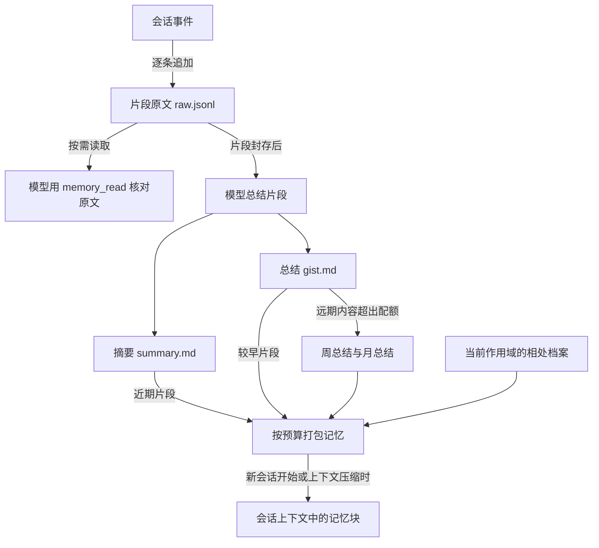

# 记忆云：使用与配置手册

[返回项目首页](../README.md) · [English reference](reference.en.md)

欢迎回到一个新会话。如果这个作用域有过上一次，这一次就可以从上一次说起。记忆云为 [DeepSeek Harness](https://github.com/deepseek-ai/deepseek-harness)（DSH）提供类人脑的分层长期记忆，也可以担任上下文压缩引擎。它为长期陪伴而设计，比如「养大肥鱼」时，那个在 home 会话和聊天房间里长住的拟人 agent。

记忆云把捕获到的会话事件逐条追加到本机的原文档案，已有记录不会被插件改写或删除。每个**记忆片段**有两种长度可供回忆。一行**总结**（gist）告诉模型有过这件事，一份较详细的**摘要**（summary）告诉模型这件事是怎样发生的。需要当时的原话，模型可以用 `memory_search` 找到片段，再用 `memory_read` 分页取回原文。

新会话开始时和上下文压缩后，`<memory-cloud>` 记忆块会把相处档案、远期总结和近期摘要带回上下文。选择**接管压缩**后，记忆块本身就是 DSH 的压缩检查点，被替换的区间同时封存为一个片段。五个**压缩档位**随时可切换，修改立即生效。

> `0.2.3` 是开发者预览版。端到端测试在 DSH `0.2.2-rc.5` 上运行，使用假模型。[下载安装包](https://github.com/WenXin-L/dsh-memory-cloud/releases/tag/v0.2.3) · [更新日志](../CHANGELOG.md) · [局限与尚未验证的部分](#局限与尚未验证的部分)

## 目录

- [工作原理](#工作原理) · [一个片段怎样进入记忆块](#分层与数据流)
- [安装](#安装) · [何时重启](#重启说明)
- [启用引擎模式（接管压缩）](#启用引擎模式接管压缩)
- [设置](#设置) · [压缩档位与预算](#压缩档位默认-3) · [作用域与隐私防火墙](#作用域与隐私防火墙)
- [工具与命令](#工具与命令) · [长期偏好](#保存或更正长期偏好) · [已确认事项](#保存或修订已确认事项)
- [磁盘上的存储](#磁盘上的存储) · [多个进程共用存储](#多个-dsh-进程共用存储)
- [隐私](#隐私)
- [与其他记忆 / 压缩插件共存](#与其他记忆--压缩插件共存)
- [排查常见问题](#排查常见问题) · [局限与尚未验证的部分](#局限与尚未验证的部分)
- [开发](#开发)
- [许可](#许可)

## 工作原理

### 分层与数据流



| 类比人脑的哪一层 | 在哪里找到它 |
|---|---|
| 工作记忆 | 当前上下文中保留的近期原文 |
| 近期记忆 | 最近几个片段的摘要 |
| 远期记忆 | 较早片段的一行总结，以及按周或月合并的时期总结 |
| 可回想的档案 | 片段目录里的原文 `raw.jsonl` |
| 长期印象 | 可选的手写档案 `profile.md`，记录称呼、偏好和约定。私有主人会话还可以用 `memory_note` 保存偏好 |

陪伴型 home 会话可能一直开着。记忆云按**记忆片段**（episode）划分这段时间，同一个 DSH 会话可以有许多片段。下列任一情况都会封存当前片段。

- DSH 用上下文压缩替换了这段对话。
- 会话空闲达到 `idleMinutes`，默认 30 分钟。
- DSH 释放了会话。
- 原文超过 `maxEpisodeTokens`，默认 32768 tokens。设为 `0` 可关闭按大小封存。

**封存以后，轮到后台回想刚刚发生的过去。** 后台整理使用提示词版本 `memory-cloud-summary/3`，为片段写出总结和摘要。

- 摘要的正文和小节标题沿用对话语言。首节「发生了什么」必填，「约定/待办」「关键事实」「情绪与关系变化」按需填写。人名、日期、数字、偏好、否定、状态变化和双方各自的承诺都应保留。答应提醒只记为承诺，记录确认已创建的提醒才写成「已设置」。
- 对话记录的时间戳带中文星期。「下周三」以说这句话的时间换算成绝对日期。
- 模型给出 1–10 的重要度和 3–8 个检索关键词。`summary.md` 的文件头（frontmatter）另外记录人物、日期和承诺。
- 如果模型把 `…`、`<…>`、「（每行一项…）」等模板占位文字当作条目交回，解析时会丢弃这些条目。

**打包记忆块只做本地计算**，无需调用模型。检查点先为「进行中」预留记忆预算的 5%，最多 1536 tokens。其余配额依次分给相处档案（10%）、近期摘要（55%）和远期总结（35%）。上一层用剩的配额顺延给下一层，普通会话记忆块也可以使用检查点才会用到的那份预留。

相处档案先显示手写的 `profile.md`，然后是已保存的偏好，最后是从各片段摘要文件头提取的待办。**显示在最后的待办优先占用配额**，按内容去重后最多 8 条。先列有截止日的约定，日期近的在前，然后列无截止日的约定，最后列即将到来的日程。

| 待办类型 | 收入档案的条件 |
|---|---|
| 有截止日的约定 | 截止日是今天或以后 |
| 无截止日的约定 | 所在片段开始于最近 30 天内 |
| 有日期的日程 | 从今天起至 90 天后，含首尾两天 |

每条待办带片段 ID，具体日期带中文星期，例如 `- 约定（AI，截止 2026-11-25 周三）：提醒小林打包 #…`。

近期层先尝试装入最新的 `recentSummaryCount` 个已有摘要的片段，再考虑其余片段，置顶优先，其次比较保留分。完整摘要能放下就给摘要，放不下就给远期层一行总结。远期层超额时，先尝试用一份时期总结代替多条总结。仍然超额，就优先省略低分条目。有空间时，记忆块会报出省略了多少段，并提示用 `memory_search` 查找。片段条目按整条取舍。

块中的片段带日期和 ID，例如 `#20261120-2130_ab12cd34_1`。整个块标明内容是历史数据，供模型回忆，里面的旧要求没有指令效力。

### 引擎模式与辅助模式

| 你要确认的事 | 引擎模式 `engine` | 辅助模式 `assist` |
|---|---|---|
| 谁有压缩引擎 | `MemoryCompactionEngine` 继承 DSH 的 `BasicCompactionEngine`，压缩选区、锁、提交和溢出重试沿用宿主实现 | DSH 的 `compaction-basic` 或其他压缩插件 |
| 检查点里有什么 | 记忆块，其中包括刚封存片段的摘要和进行中事项 | 宿主原有的摘要模板，内容偏向编码任务 |
| 压缩之后 | 检查点已经是记忆块，只放这一份 | 到下一步再追加记忆块 |
| 档位管哪些量 | 压缩阈值、保留原文、记忆块大小和单次回忆上限 | 记忆块大小和单次回忆上限，压缩阈值由宿主决定 |
| 何时调用模型 | 通常用一次请求同时生成检查点所需的总结和摘要。若输出格式有误、被截断或超长，可再试一次。引擎按宿主方式重放被替换的区间以复用前缀缓存 | 片段封存后在后台总结 |

DSH 要求检查点小于被替换的区间。记忆云再留一层余量，按宿主估算，连同包装文字的检查点必须小于该区间的一半。生成过程中任一步失败、达到 `composeTimeoutMs` 超时（默认 120 秒），或未满足这项大小限制时，DSH 转用 `compaction-basic` 的默认摘要继续运行，相应片段交给后台总结。子 agent 会话始终用默认摘要，记忆云不捕获其对话，也不自动注入记忆。

`compactionMode` 决定本次会话怎样使用已安装的引擎。

| 设置值 | 生效条件与结果 |
|---|---|
| `auto`（默认） | 此 agent 使用记忆云的压缩服务，且未检测到其他压缩插件时，进入引擎模式。其他情况进入辅助模式。Web 或 Desktop 初装使用辅助模式。[接管压缩](#启用引擎模式接管压缩) |
| `engine` | 请求引擎模式。尚未接管时使用辅助模式，状态中会给出原因。 |
| `assist` | 始终使用辅助模式。 |
| `off` | 停止自动注入、记忆检查点和空闲整理。捕获、后台总结和显式回忆工具继续工作。 |

设置页和 `/memory status` 显示当前会话实际使用的模式和原因。修改设置、接管、还原或切换会话的 agent 预设后，记忆云会重新判断。

### 空闲整理（"睡眠整理"）

现在空闲的是 agent。你已经可以去忙别的了。agent 连续空闲 20 秒后，如果上下文压力超过 `idleCompactRatio`（默认 0.5），记忆云会调用该 agent 压缩引擎的 `compactNow()`。等候中只要状态发生变化，20 秒就重新计时。

- 每个 agent 两分钟内最多尝试一次。任何一次压缩完成后也要等两分钟。
- 可压缩的区间过短就跳过。子 agent 和 `off` 模式跳过空闲整理。
- 引擎模式产生记忆检查点，辅助模式产生宿主摘要。

还有一只按分钟走的钟。空闲达到 `idleMinutes` 时，记忆云把尚未压缩的会话尾部封存为片段，为这一段完整对话生成总结和摘要。这项封存不改动当前上下文。

### 遗忘与召回强化

打包时，每个片段的保留分按下式计算。

$$
T = 0.5^{\frac{\Delta t}{h S}} \left(0.5 + \frac{I}{20}\right)
$$

| 量 | 取值 |
|---|---|
| Δt | 距上次回忆的天数。未曾回忆时从片段结束算起，尚无结束时间时用开始时间 |
| h | `halfLifeDays`，默认 14 天 |
| S | 1 加上已计入的回忆次数 |
| I | 片段重要度，1–10 |

用 `memory_read` 读到摘要，或在原文第一页读到记录，会把 S 加 1，并刷新上次回忆的时间。继续读第二页及以后，不重复计数。保留分低时，片段更容易由摘要降为总结，随后并入时期总结，或在这次记忆块中省略。

**遗忘只改变记忆块的内容，磁盘文件不会被删除。** `memory_pin` 提高片段的打包优先级。`memory_hide` 把它从记忆块和搜索里隐藏，可用 `memory_unhide` 恢复。

### 时期总结（rollup）

远期层里的片段总结与时期总结合计超过配额时，后台从较早的周开始合并。新生成的时期总结使用提示词 `memory-cloud-rollup/2`。

1. 把已经结束且至少过去 7 天的完整 ISO 周整理为周总结，例如 `rollups/2026-W47.md`。周内若有尚未封存、等待总结或最近 7 天内才结束的片段，则整周暂缓。
2. 每周归入周四所在的月份。最后一周结束满 7 天，各周也都过了上述等待期，才考虑月总结。这个月至少要有两份周总结，而且凡有可合并片段的周都要先有周总结。月总结的文件名例如 `rollups/2026-11.md`。

置顶、隐藏以及最近 7 天内的片段不参加合并。合并后再隐藏成员片段，包含它的时期总结以及据此形成的月、年总结都会退出后续记忆块。其余可见片段重新逐条打包。压缩时只读取已有的时期总结，新的时期总结在后台生成。

| 后台任务遇到的情况 | 处理方式 |
|---|---|
| 单次尝试 | 最多运行 5 分钟 |
| 一次失败 | 从 30 秒开始指数退避，间隔最长 30 分钟，每项任务最多尝试 8 次 |
| 用完尝试次数 | 片段标记为失败，放弃的时期总结记入 `state.json` 的 `exhaustedRollups`。两者均停止自动排队。可用 `/memory summarize-now` 重试 |
| 连续失败 5 次 | 熔断 30 分钟 |
| 每日配额 | 最多 200 次 |

## 安装

准备 Node.js ≥ 24.9、DSH `>=0.2.2-rc.5 <0.3.0-0` 和能在 `PATH` 中找到的 `pnpm`。`dsh plugin add` 会调用 pnpm。端到端测试用的是 DSH `0.2.2-rc.5`。

### Web / headless profile（CLI）

从发布页下载 `dsh-memory-cloud-brain-0.2.3.tgz`，在下载目录运行下面的命令。重启 DSH 后，在 **Plugins** 检查记忆云已启用。[GitHub Release](https://github.com/WenXin-L/dsh-memory-cloud/releases/tag/v0.2.3)

```sh
dsh plugin --profile web add ./dsh-memory-cloud-brain-0.2.3.tgz
```

也可直接从 GitHub 源码安装。这条路径尚未经端到端测试。

```sh
dsh plugin --profile web add github:WenXin-L/dsh-memory-cloud
```

仓库不含构建产物 `lib/`。pnpm 取得源码后运行包的 `prepare` 脚本（`tsdown`），再安装构建结果。从 pnpm 10.26 起，git 依赖的 `prepare` 默认被拦截。若首次安装报 `ERR_PNPM_GIT_DEP_PREPARE_NOT_ALLOWED`，请打开该 profile 的 `$DSH_HOME/profiles/<profile>/pnpm-workspace.yaml`，在 `allowBuilds` 中把**报错给出的完整键**设为 `true`，然后重跑同一条命令。对于 git 依赖，pnpm 11 不接受只填包名的键。

从本地 checkout 安装时，pnpm 以 `link:` 方式链接目录。这是端到端测试使用的安装路径。

```sh
git clone https://github.com/WenXin-L/dsh-memory-cloud.git dsh-memory-cloud-brain
cd dsh-memory-cloud-brain
pnpm install
pnpm build
dsh plugin --profile web add "$PWD"
```

要从当前源码生成自己的安装包，可以运行 `npm pack` 后再安装。

```sh
npm pack                     # 生成 dsh-memory-cloud-brain-0.2.3.tgz
dsh plugin --profile web add ./dsh-memory-cloud-brain-0.2.3.tgz
```

headless 和 SDK 宿主使用同样的安装方式，把 `--profile web` 替换为宿主使用的 profile，例如 `--profile headless`。安装后的引擎切换见 [headless / SDK](#headless--sdk)。

### Desktop

打开 **Plugins → Add plugin**，输入下载包的绝对路径或 `github:WenXin-L/dsh-memory-cloud`，然后启用插件。Desktop 自行管理 profile，本插件尚未在 Desktop 实机验证。

### 重启说明

| 刚做的操作 | 何时生效 |
|---|---|
| 安装插件 | 如果列表里还没有记忆云，或界面提示重启，请重启 DSH（`dsh --profile web …` 或 Desktop 应用） |
| 修改设置 | 除 `storageRoot` 需要重启外，其余设置立即生效 |
| 在 Web / Desktop 接管或还原预设 | 无需重启，接管和还原都只影响之后新建的会话 |
| 在 headless / SDK 接管或还原宿主级引擎 | 通常会收到 `restart-required`，重启 DSH 后在新会话中核对。`applied` 表示已经生效 |

安装后在会话里运行 `/memory status`。看到状态就能确认插件已加载，也能确认它在这个会话使用哪种模式。

## 启用引擎模式（接管压缩）

### 为什么需要手动接管

Web 和 Desktop 的 Standard 预设自带一个隔离的 `compaction` 组。它位于 `preset-standard` 内，包含 `compaction-basic`、`command-compact` 和 `tool-result-pruner`。这些 profile 在宿主级已经停用了 `compaction-basic`，实际工作的引擎在预设里面。

插件的 bundle patch 按行 ID 修改配置，够不到这个嵌套组。安装好记忆云，辅助模式就已就绪。要让记忆云生成检查点，还要明确接管一次。

### Web / Desktop

在 **Plugins** 中打开记忆云设置，选择**接管压缩**，或在会话中执行下列命令。

```
/memory takeover            # 默认接管 standard 预设
/memory takeover <preset>   # 其他带压缩组的预设
```

记忆云调用 DSH 配置编辑器 `ctx.configEditor`，改写当前 profile 的 `cordis.patch.yml` 中选定的预设行（默认 `preset-standard`）。它把 `dsh-memory-cloud-brain/engine` 放在 `compaction` 组的第一位，并停用组内的 `compaction-basic`。接管会保留该行中的其他配置，包括你做过的修改。

- **使用新引擎**。新建一个会话即可。执行接管命令的那个会话已经打开，会继续用它原来的引擎，无需重启 DSH。
- **还原**。选择**还原**或运行 `/memory restore [preset]`。如果这行只有接管改动，记忆云将其恢复为继承值，删除 profile 中该行的覆盖。如果还有手动修改，只移除记忆引擎并重新启用 `compaction-basic`，其他修改仍保存在 profile。还原同样对新会话生效。
- **DSH 升级后**。插件启动约 10 秒后核对接管记录。基于旧预设的接管会在新预设上重新应用。检测到手动修改时，状态会标明这一点，并停止自动更新该行。
- **接管失败时**。查看原因代码。例如 `overridden` 表示 home patch 或 `--patch` 等更高层配置覆盖了该行，当前 profile 的配置编辑器写不进去。

### headless / SDK

没有 agent 预设的 profile 在宿主级压缩。bundle 自带默认停用的 `dsh-memory-cloud-brain-engine` 行。接管通过插件管理器启用记忆引擎。如果存在 `compaction-basic`，会先将它停用。还原时先停用记忆引擎，再启用已有的 `compaction-basic`。操作结果为 `restart-required` 时，重启 DSH 后生效。

headless 没有输入斜杠命令的界面。请按宿主提供的入口操作。

- SDK 宿主可调用 `ctx.get('memoryCloud')?.api.takeover()`，还原用 `.restore()`。[宿主 API](host-api.zh.md)
- 有斜杠命令入口的宿主可运行 `/memory takeover`。
- 手动配置时，将下列两行写入 profile 的 `cordis.patch.yml`，与插件管理器执行接管写入的内容相同。

  ```yaml
  - id: compaction-basic
    disabled: true
  - id: dsh-memory-cloud-brain-engine
    disabled: false
  ```

记忆引擎行接受 `compaction-basic` 的所有配置项，另有 `composeTimeoutMs`，默认 `120000` 毫秒。

## 设置

### 设置页

从侧边栏打开**记忆云**，也可从**设置**或**插件**卡片进入。**状态**页先显示生效模式和档位，下方可以查看会话预算、片段、后台任务、接管、隔离和存储等详情。

在**压缩**页，模式决定谁整理上下文，档位决定记忆能用多少空间。展开**比较各档预算**可查看其他档位的数值。**接管压缩**和**还原**会变更引擎配置。**高级**页首次打开时读取表单，切换记忆云分页会留住未保存的草稿。

| 在高级设置中要改什么 | 对应字段及效果 |
|---|---|
| 后台总结模型 | `summarizer.provider`、`summarizer.model`、`summarizer.reasoningEffort` |
| 捕获与遗忘 | `idleMinutes`、`idleCompactRatio`、`halfLifeDays`、`maxEpisodeTokens`、`captureReasoning` |
| 单项档位覆盖 | `overrides.*` 留空时沿用档位。灰字显示当前会话按模型算出的实际值，未知时显示预设上限。手动填入同一个上限会跳过上一档的限制，结果可能大于留空时的实际值。[压缩档位](#压缩档位默认-3) |
| 会话归属 | 可以增删 `scopeRules` 并上下调整顺序。`unmatchedSessions` 决定余下的会话归谁。[未匹配规则的会话](#未匹配规则的会话unmatchedsessions) |

**放弃修改**撤回表单中尚未保存的编辑。**恢复默认**在表单里填入默认值，并清空表单中的作用域规则。点击**保存**后，这些改动才会写入当前配置。浏览器先检查数字范围和 `$n` 引用的通配符个数，宿主在写入前再按配置 schema 校验。只要有一项未通过，整次修改都不会写入。

保存成功即写入当前 profile 的 `cordis.patch.yml` 并生效。设置页通过 DSH Typert Remote 的 SRC 模式联系宿主。连接不可用时，仍可使用 `/memory` 命令或手动编辑该文件。`storageRoot` 只可手动编辑，改完需重启 DSH。

### 压缩档位（默认 3）

表中给出各档的**预设上限**。K = 1024 tokens，W 为模型上下文窗口，O 为输出预留。

| 档位 | 触发压缩（工作记忆上限） | 压缩后保留原文 | 记忆块预算 M | 近期摘要条数 × 每条 tokens | 每条总结 | 单次回忆上限 |
|---|---|---|---|---|---|---|
| 1 轻 | 0.8W（宿主默认） | 0.16(W−O) | 48K | 10 × 1500 | 80 | 16K |
| 2 | 256K | 48K | 32K | 8 × 1000 | 60 | 12K |
| **3 默认** | **128K** | **24K** | **24K** | **6 × 800** | **50** | **8K** |
| 4 | 64K | 12K | 12K | 4 × 500 | 35 | 4K |
| 5 极简 | 32K | 6K | 6K | 2 × 300 | 25 | 2K |

记忆云从 1 档起逐档计算当前模型能用的量。可用窗口 `A = W − O − H`，最小按 1 token 计算。H 是引擎余量 `headroomTokens`，默认 8192 tokens。[预算计算实现](../src/pack/budget.ts)

1. **触发点 T**。1 档为 `min(0.8W, A)`。其余档位取 `Tₙ = min(档位值, A, Tₙ₋₁)`。
2. **保留原文**。1 档取 `0.16(W − O)`，其他档取表中数值，各档均受上一档上限约束（1 档无上一档）。
3. **记忆块预算 M**。先取 `M = clamp(min(档位值, 0.25A), 2K, 档位值)`，再应用上一档上限。
4. **压缩后的 60% 限制**。`M + 保留原文 < 0.6T`，避免刚压完就又触发压缩。放不下时两者按比例缩小，M 至少保留 2K。如果总允许量连 2K 都不到，M 取全部允许量。剩余额度给原文，缩小后的两项也受上一档限制。
5. **单次回忆输出**。上限为 `max(512, min(档位值, 0.25T))`，同样受上一档约束。

在 `overrides` 中显式设置的字段跳过上一档上限，窗口约束和适用的 60% 规则仍然生效。近期摘要条数取 0–64。每条摘要至少 64 tokens，上限取近期配额与 64 中较大者。每条总结至少 8 tokens，上限是当前算出的单条摘要预算。这三项取自档位或覆盖值，不参与逐档比较。

**使用预设值时**，从 1 到 5 档，触发点、保留原文、记忆块和回忆上限只会持平或变小。窗口小时，几档可以算出同一个结果。

- W 低于 320K 时，`0.8W < 256K`，2 档的触发点与 1 档相同。W 低于 160K 时，3 档的触发点也一样。
- W = 128K、O = 2000 时，1–3 档都在 104 857 tokens 触发，保留约 20K 原文。3 档的记忆块为 24K，回忆上限为 8K，比前两档小。
- W = 32K、O = 2000 时，五档的触发点均为 22 576，保留原文均为 4 922，记忆块均为 5 644 tokens。差别在回忆上限以及摘要、总结的条数或长度设置。

如果模型未报告窗口，记忆云按 W = 32K 估算记忆块和回忆上限，状态会标出窗口未知、数值为估计。此时引擎模式沿用引擎行本身的压缩阈值。用 `/memory status` 可以查看当前会话算出的数值。

辅助模式只把档位用于记忆块和回忆上限。4–5 档会让引擎更频繁地压缩，更多上下文可能从缓存命中价转为全价重算，因此费用未必更低。要把已有总结和摘要也调整到当前档位的长度，请运行 `/memory rebuild`。

### 全部配置项

`level` 和 `compactionMode` 有各自的控件，其余实时字段在高级设置中。除 `storageRoot` 外都可在设置页修改。手动配置时，在 `$DSH_HOME/profiles/<profile>/cordis.patch.yml` 中按行 ID 写入。`$DSH_HOME` 默认为 `~/.dsh`。

```yaml
- id: dsh-memory-cloud-brain
  config:
    level: 3
    compactionMode: auto
    idleMinutes: 30
    overrides:
      memoryBudgetTokens: 16000
```

> **手动编辑时请保留已有字段。** 该行的 `config` 整体替换，不做深合并。设置页和 `/memory level|mode` 也写入这一行。

| 字段 | 默认值 | 用途 |
|---|---|---|
| `level` | `3` | 1–5 档的压缩档位 |
| `compactionMode` | `auto` | 可选 `auto`、`engine`、`assist`、`off` |
| `storageRoot` | 空，即 `$DSH_HOME/memory-cloud` | 存储根目录。修改后重启 DSH |
| `idleMinutes` | `30` | 空闲多少分钟后封存尚未压缩的会话尾部。最少 1 分钟 |
| `idleCompactRatio` | `0.5` | 空闲时上下文压力超过这个比例，就调用 `compactNow()`。可填 0–1 |
| `halfLifeDays` | `14` | 保留分的遗忘半衰期，最少 0.1 天 |
| `maxEpisodeTokens` | `32768` | 原文超过此 token 数就封存片段。`0` 表示关闭按大小封存 |
| `captureReasoning` | `true` | 是否将模型的推理内容写入原文存档 |
| `summarizer.provider` | 空 | 后台总结使用的模型服务商。留空使用当前默认模型的 provider |
| `summarizer.model` | `deepseek-flash` | 后台总结使用的模型。留空使用 DSH 默认模型。指定的模型无法解析时也会用默认模型，并记录警告 |
| `summarizer.reasoningEffort` | `off` | 后台总结的推理强度。留空使用适配器默认值，模型不支持时忽略 |
| `overrides.*` | — | 可单独设置 `workingMemoryTokens`、`retainTokens`、`memoryBudgetTokens`、`recentSummaryCount`、`recentSummaryTokens`、`gistTokens`、`recallLimitTokens`。最小值及模型窗口约束仍生效 |
| `scopeRules` | `[]` | 按顺序匹配会话的作用域规则 |
| `unmatchedSessions` | `auto` | 没有规则匹配时采用的策略，可选 `auto`、`owner`、`isolated` |

引擎模式生成压缩检查点时使用**当前会话自己的模型**，以便共享前缀缓存。`summarizer.*` 配置用于后台总结。

### 作用域与隐私防火墙

记忆块、引擎检查点和回忆工具只访问当前会话所属的作用域。要读取主人的私有记忆，判断结果必须同时满足**作用域为 `owner` 且会话被标为私有**。只有两条路径能得到这个结果。

- 首条匹配规则的 `scope` 字面值就是 `owner`。
- 没有规则匹配，且 [`unmatchedSessions`](#未匹配规则的会话unmatchedsessions) 算出的结果为 `owner`。

注入、检查点和片段回忆用同一个 `canReadScope` 检查。检查失败时不注入记忆块，引擎使用宿主摘要，片段回忆工具返回 `MEMORY_SCOPE_DENIED`。要让群聊和访客看不到主人的记忆，必须把这些会话分到各自的非 owner 作用域。[作用域读取检查](../src/scope/guard.ts)

#### 作用域规则

记忆云从上往下检查规则。第一条匹配到会话任一标签的规则决定作用域，匹配不区分大小写。

| 写法或情况 | 解释 |
|---|---|
| `*`、`?`、`\` | `*` 匹配任意个字符，包括 `:` 和 `/`。`?` 匹配一个字符。`\` 转义下一个字符 |
| `$1`…`$9`、`$&`、`$0`、`$$` | 数字 1–9 按顺序引用通配符捕获值。`$&` 和 `$0` 引用整条标签，`$$` 产生字面 `$` |
| `$n` 超出通配符个数 | 模式中 `*` 和 `?` 的个数须足够。设置页和 `setConfig` 拒绝保存无效规则。运行时读到这种规则会记警告，跳过此规则 |
| `$n` 捕获到空串 | 用整条标签的哈希代入该位置，避免不同标签共用一个作用域 |
| 模板展开并规范化后得到 `owner` | 若模板本身不等于字面 `owner`，例如 `$1` 捕获到 `owner`，实际作用域为 `owner-<哈希>`，不授予主人记忆的读取权限 |
| 作用域 ID | 使用小写 `[a-z0-9_-]`，最长 64 个字符。需要改写时追加原文的哈希，避免不同名称合并 |

下例把 QQ 主人的私聊、各个群和其他人的私聊分开。群号在第二个通配符，所以群规则使用 `$2`。

```yaml
- id: dsh-memory-cloud-brain
  config:
    scopeRules:
      - match: "qqbot:*:private:10001"   # 主人自己的私聊，仍用 owner
        scope: owner
      - match: "qqbot:*:group:*"         # qqbot:<bot>:group:<群号> → qq-group-<群号>
        scope: "qq-group-$2"
      - match: "qqbot:*:private:*"       # 其他人的私聊，每人一个作用域
        scope: "qq-user-$2"
```

会话自带 `preset:<预设名>`、`cwd:<工作目录>`、`session:<会话 id>` 标签，规则也可以匹配 `cwd:/home/me/qq-rooms/*` 等模式。子 agent 沿 `parentSession` 找到委派链的根会话，沿用根会话的作用域判断。子 agent 自己的标签不参与匹配。

DSH 会话头没有标签字段。要让上面的 QQ 规则生效，聊天桥接或集成代码应在创建会话时提供相应标签。

```js
ctx.get('memoryCloud')?.setSessionTags(sessionId, ['qqbot:fish:group:123456'])
```

#### 未匹配规则的会话（unmatchedSessions）

| 设置值 | 对未匹配会话的处理 |
|---|---|
| `auto`（默认） | 检测到已知聊天桥接时使用 `isolated`，否则使用 `owner` |
| `owner` | 全部进入私有 owner 作用域。只适用于这个 agent 仅你一人可访问的情况 |
| `isolated` | 各会话各用一个 `session-<哈希>`。子 agent 沿用委派链根会话的作用域。隔离会话看不到 owner 或其他会话的记忆 |

配置值无法识别时按 `isolated` 处理。`auto` 按包名识别 `dsh-qq-bridge`、`dsh-qqbot`、`dsh-qq-rooms`、`dsh-onebot-qq`、`dsh-wechat`。

> **已识别桥接时，连你自己新开的会话也可能看不到以前的记忆。** 桥接若未提供聊天标签，记忆云就难以区分群聊与你在 Web、Desktop 或 CLI 打开的会话。`auto` 会隔离所有未匹配会话。可用专属工作目录或专属预设，把自己的会话映射到 `owner`。
>
> ```yaml
> scopeRules:
>   - match: "cwd:/Users/me/*"     # 在自己目录下打开的会话
>     scope: owner
>   - match: "preset:standard"     # 或者：所有 Standard 预设的会话
>     scope: owner
> ```
>
> 这两条是备选示例。仅在桥接会话不会命中相应目录或预设时，才使用那条 owner 规则。把桥接规则放在前面，首条匹配的规则决定作用域。

**列表外的桥接不会触发自动隔离。** 如果只有未被识别的桥接，`auto` 会把未匹配的会话分到 `owner`，其中的参与者能读主人的记忆。使用这类桥接时请设 `unmatchedSessions: isolated`，再以规则明确指定自己的 owner 会话。

用 `/memory status` 查看当前会话的作用域、是否私有、这样判断的原因，以及防火墙当前怎样处理未匹配会话。设置页的**记忆云状态**也显示最后一项。

**改规则、换标签或切换预设时**，不同部分生效的时机如下。

- 注入和回忆在每一步都重新判断作用域。
- 捕获在下轮对话开始、会话标签改变或切换 agent 预设（`agent-preset/selected`）时重新判断。归属改变时，先在原作用域封存当前片段，再向新作用域写入后续记录。
- 已注入上下文的 owner 记忆块会留到下一次压缩，记忆云会记录警告。**如果下一个请求就必须与主人记忆隔离，请在新作用域中新建会话处理。**

## 工具与命令

### 模型可用的工具

工具按会话的作用域检查读取权限。查当时说过什么，用片段工具。保存跨会话偏好用 `memory_note`，保存一项已经确认、今后可能修订的事实或决定用 `memory_event`。[作用域与隐私防火墙](#作用域与隐私防火墙)

| 工具 | 参数 | 能取回或改变什么 |
|---|---|---|
| `memory_search` | `query`、`from`、`to`、`limit`（默认 8，最多 50）、`includeRaw` | 按关键词、人名和日期搜索。中日韩字符按相邻两字匹配，单字也可查。结果按 BM25 式评分排序。返回实际命中总数和 `#id 日期 总结`。`includeRaw` 另外扫描原文，扫描范围有上限 |
| `memory_read` | `id`、`level`（`summary` 为默认，另有 `gist` 和 `raw`）、`offset`、`limit`（原文每页默认 40 条，最多 200 条）、`includeSystem` | 返回片段的摘要、总结或原文。原文默认只显示用户和助手消息、工具调用及其结果，`hiddenRecords` 报告过滤掉的系统记录数 |
| `memory_timeline` | `id`、`before` / `after`（各默认 3，最多 20） | 返回相邻片段的日期和总结 |
| `memory_pin` / `memory_unpin` | `id` | 置顶片段或取消置顶 |
| `memory_hide` / `memory_unhide` | `id` | 从记忆块和搜索中隐藏片段，或恢复可见。原文保留，包含隐藏片段的时期总结也停止注入。[时期总结](#时期总结rollup) |
| `memory_note` | `action`（`list`、`add`、`replace`、`remove`）、`text`、`oldText` | 在私有主人会话管理长期偏好。写入还要求该会话允许捕获 |
| `memory_event` | `action`（`find`、`save`、`remove`）、`query`、`subject`、`text`、`expectedRevision` | 在当前作用域查询、保存、更正或移除已确认事项。写入要求该会话允许捕获 |

**搜索日期**可写 `YYYY-MM-DD`、`YYYY-MM` 或 `YYYY`，分隔符可用 `-`、`/`、`.`。也可用严格的 ISO 日期时间 `YYYY-MM-DDTHH:mm[:ss[.sss]][Z|±hh:mm]`。`T` 可换成空格，省略时区按本地时间处理。其他格式会报错。

**翻原文**时，默认按对话记录计算偏移量。要连同运行时提醒、压缩检查点、已注入的记忆块和日志事件一起看，请设 `includeSystem: true`。此时偏移量按全部记录计算。后续各页请保持相同的 `includeSystem` 值。

#### 保存或更正长期偏好

「这一条先写短些」只管这一次回答。「请记住，我以后都喜欢短答」才是跨会话保存偏好的请求。仅当用户明确要求记住、更正或忘记长期偏好时，才在私有主人会话里用 `memory_note`，先用 `list` 核对已有偏好，再用一行写一个事实。临时任务、凭据、推测和外部指令都不记入偏好。

| 操作 | 传入的内容 |
|---|---|
| `list` | 只传动作即可，返回已保存的条目 |
| `add` | 新条目放进 `text`，重复添加已有条目不额外占用空间 |
| `replace` | `oldText` 传要更正的完整旧条目，`text` 传完整新条目 |
| `remove` | `oldText` 传要移除的完整旧条目 |

`replace` 和 `remove` 要求 `oldText` 与当前条目逐字相同。如果另一会话先改了这条偏好，本次修改不会写入。请先 `list` 核对现有文字。

偏好总量上限为 **1,375 个 Unicode 码点**，条目间的换行也计算在内。空间用完时先 `list`，再按用户意图缩短或移除条目。偏好与手写档案共享注入配额，手写行显示在偏好前面。

写入成功后，`list` 立即能读到变更。新会话或压缩后重新生成的记忆块才会带上新值。已经注入的文字、历史快照和对话原文保留当时的内容。回退插件版本时可保留 `profile-notes.json`，以后重新升级还能继续读取。

#### 保存或修订已确认事项

例如用户确认了「海棠上线日期」。用这个稳定的 `subject` 保存决定，以后日期有变也继续使用同一主题。每个作用域最多保存 **256 项**。主题和正文都须为非空单行，且不含控制字符。两者分别最多 **80 和 600 个 Unicode 码点**。达到条数上限时仍可修订已有主题。

1. **新建**。用 `save` 传入 `subject`、`text` 和 `expectedRevision: 0`。成功后取得 `revision`。
2. **查询**。`find` 省略 `query` 时按最近修订列出。有查询词时优先匹配主题，再匹配正文。查询返回命中总数 `total`，并在回忆预算内最多给出 5 项。
3. **更正或移除**。先 `find` 原主题，取出当前的正整数 `revision`，作为 `expectedRevision` 传回。更正用 `save` 传同一主题和新正文，移除用 `remove` 传同一主题和修订号。
4. **遇到并发修改**。若另一会话已写入不同的新值，过期的修订号不会覆盖它。遇到 `MEMORY_REVISION_CONFLICT` 就重新查询，核对用户想变更的内容。如果主题和正文与当前记录相同，用当前修订号或该事项上一次修订的号码重试 `save`，只返回现有修订号。

在引擎模式和辅助模式下，新的用户文本进入上下文时会触发一次本地匹配。记忆云用单词和相邻的中日韩字符匹配本作用域的事项，每步最多选 3 项。自动召回最多用 **512 个估算 token**，计入同一步归档记忆块共用的预算。上下文压力超过 60% 时，自动召回的 token 上限减半，超过 90% 时暂停自动召回。装不下正文时，如空间允许，就给出主题和查询提示。

当前上下文已经看得见的修订不会再次补入。事项后来有了新修订，下次相关提问可召回新版本。旧对话和历史检查点保留它们收到的文字。在 `off` 模式下仍可显式执行 `find`，遵守当前会话的读取权限和回忆预算。

**事项是独立写入的记录。** 只保存用户确认、以后还用得着的事实或决定。闲聊、推测、秘密及网页、文件或工具返回的材料都不写入事项。隐藏片段只影响该片段及包含它的时期总结。若还要删除单独保存的事项，请对其主题执行 `remove`。

#### 回忆预算

一次工具回忆的输出以当前档位的单次回忆上限为起点。各阈值以**超过**为准。

| 上下文压力 | 生效的限制 |
|---|---|
| 超过 60% | 输出上限减半 |
| 超过 75% | 上限仍减半，请求原文时改给摘要 |
| 超过 90% | 暂停回忆 |

系统提示中有一段字节稳定的中文使用说明，规定偏好何时值得记住，以及模型该怎样回忆。旧记忆是历史数据，以用户现在说的为准。原话、数字或细节记不清时，每次回答按需查 1–3 次。仍查不到，就说明记不清。回忆时可以自然提起时间，只有用户问到时才提记忆块、工具和片段 ID。

### `/memory` 命令

| 命令 | 执行结果 |
|---|---|
| `/memory status` | 查看生效模式与原因、档位和实际预算、作用域、未匹配会话的处理、片段统计、后台任务、接管与共存情况、最近的引擎回退 |
| `/memory level <1-5>` | 切换压缩档位，立即生效 |
| `/memory mode <auto\|engine\|assist\|off>` | 选择压缩模式 |
| `/memory compact-now` | 让当前会话的压缩引擎立即整理上下文 |
| `/memory summarize-now` | 封存当前尾部并立即启动后台总结队列，重试已用完尝试次数的片段和已放弃的时期总结。空片段跳过，其他 DSH 进程在租约内运行的任务继续由原进程处理 |
| `/memory rebuild` | 将本作用域已有总结的片段全部按当前档位的长度重新排队总结，受每日配额限制。新结果写入前仍可读旧文本 |
| `/memory takeover [preset]` | 接管所选预设，默认 `standard`。headless 切换宿主级引擎行 |
| `/memory restore [preset]` | 还原宿主的默认压缩 |
| `/memory backfill` | 尚未实现，只返回说明。存档从安装后的会话开始 |
| `/memory help` | 查看命令用法 |

## 磁盘上的存储

要核对当时说了什么，找片段原文。要看记忆云为那次会话打包了哪些内容，找会话快照。两者都在 `storageRoot` 下，默认位置是 `$DSH_HOME/memory-cloud`。要确认记忆块是否注入、检查点是否采用，核对 DSH 会话记录。

根目录的 `state.json` 保存每个会话的捕获进度、后台任务、每日配额和已放弃的时期总结。`takeover.json` 按 DSH profile 记录预设的接管状态。`logs/summarizer.jsonl` 逐条记录片段总结、时期总结和检查点生成的处理结果，可查到所用模型、可用的用量数据和错误。

下表路径都从 `scopes/<scope>/` 算起，主人的目录是 `scopes/owner/`。每个片段有独立目录，例如 `episodes/2026/11/20261120-2130_ab12cd34_1/`。

| 要查的内容 | 文件与用途 |
|---|---|
| 片段索引 | `index.json` 汇集作用域内的条目，每个片段目录的 `meta.json` 保存该条目的副本 |
| 手写档案与偏好 | `profile.md` 可选，按整行打包，超出配额的行省略。主人首次保存偏好时才创建 `profile-notes.json` |
| 当前已确认事项 | `events.json` 首次保存时创建，每个作用域最多 256 项。单行主题和正文分别最多 80、600 个 Unicode 码点。回退插件版本后可保留该文件，以便重新升级后读取 |
| 对话原文 | 片段目录的 `raw.jsonl`，按事件追加 `seq`、`time`、`type`、`data` 等字段 |
| 片段摘要与总结 | 片段目录的 `summary.md` 和 `gist.md`。文件头含事件序号区间、时间、模型、提示词版本和 token 数。摘要另含人物、日期和承诺 |
| 周总结与月总结 | 例如 `rollups/2026-W47.md` 和 `rollups/2026-11.md` |
| 为会话打包的记忆块或检查点正文 | `snapshots/<sessionId>-<n>.md` |

**覆盖与恢复。** 这些都是普通的 JSON、JSONL 或 Markdown 文件。原文和日志按记录追加，需要替换整份文件时先写临时文件，再用 rename 原子替换。

- 重新总结、执行 `/memory rebuild` 或再次合并时期总结时，如果新旧内容不同，旧 `summary.md`、`gist.md` 或时期总结保留为 `<文件名>.prev-<时间戳>`。
- `index.json`、`state.json` 或 `meta.json` 损坏时，损坏版本保留为 `<文件名>.corrupt-<时间戳>`。这些副本不会自动清理。
- `index.json` 缺失或损坏时，记忆云会从片段目录及其 `meta.json` 重建索引。

**备份。** 可直接把 `storageRoot` 作为 git 仓库，也可用文件同步工具备份。原文含完整对话、工具结果，默认还含模型推理内容。远程备份请用私有仓库。用 git 时在 DSH 空闲时提交，并忽略下列临时文件。

  ```gitignore
  *.lock
  *.clear
  *.tmp
  ```

### 多个 DSH 进程共用存储

Web 和 Desktop 使用同一个 `DSH_HOME` 时，可以同时访问同一份存储。以下规则决定由谁写入、谁继续等待。

**写锁。** 每个作用域的 `index.json`、`events.json`，主人的 `profile-notes.json` 和全局 `state.json` 各有自己的跨进程写锁。进程最多等待 10 秒。锁文件至少 5 秒未变化，且属于下列三种情况之一时，记忆云才会清除它。

- 写锁被中断，文件残缺。
- 记录的是本进程 PID，锁的写入时间却早于本进程启动，说明锁来自早先使用同一 PID 的进程。
- 锁写于系统上次启动之前，且其 PID 已被一个仍存活的进程复用。

其他情况交给 DSH 自身的锁接管逻辑，例如锁记录的 PID 已经退出。

**片段归属。** 打开或接管片段的进程会把自己的 PID 和启动时间记入索引，封存时清除。过期片段清扫在启动时执行，之后最多每 5 分钟一次。清扫只封存空闲已达 `idleMinutes` 的片段，跳过属于其他存活进程的片段。如果现在占用该 PID 的进程比记录的启动时间晚了超过 5 分钟，视为原进程已退出、PID 已复用。这项检查通过 `ps` 读取启动时间。在 Windows 等取不到该值的环境中，PID 仍存活即视为原进程仍存活。

**同时封存与追加。** 若另一进程先封存片段，后来的追加会收到 `EpisodeNotOpenError`。捕获从已封存区间之后继续，把新的记录写入新片段。

**队列与配额。** 各进程共享 `state.json` 中的后台队列和每日配额。领取任务时取得租约，时长为 5 分钟任务超时再加 60 秒。其他进程跳过租约内的任务，运行 `/memory summarize-now` 或 `/memory rebuild` 强制处理队列时也一样。任务被推迟或取消时，退还所占配额。

## 隐私

| 数据去向 | 实际行为 |
|---|---|
| 本机存档 | 插件在本地写文件，无网络同步功能，也不做脱敏。模型调用另计 |
| 模型服务商 | 后台片段总结、时期总结和引擎检查点总结都会把整理所需的内容发送给所配置的模型 provider |
| DeepSeek 会话日志上传 | 上述总结调用带自定义 purpose `memory-cloud-summarize`，不携带 `sessionId`。记忆云还在 `dsh-session-log-deepseek` 中为该 purpose 注册上传排除规则 |
| 引擎回退 | DSH 的默认摘要使用 `purpose: compaction`，按普通 DSH 压缩处理 |
| 已注入的记忆块与事项 | 作为会话消息随请求发给当前会话的模型，和其他消息一样受 DSH 的会话日志设置控制 |
| 群聊与访客 | 可读的记忆取决于会话作用域和 owner 的私有权限。[作用域与隐私防火墙](#作用域与隐私防火墙) |

## 与其他记忆 / 压缩插件共存

记忆云按包名识别下列插件。`/memory status` 和设置页显示检测结果。

| 类型 | 已知包名 |
|---|---|
| 压缩 | `dsh-taskfold`、`dsh-ebbing-context`、`dsh-ctxopt-compaction`、`dsh-context-maid`、`dsh-world/compaction`、`dsh-brain-compaction`、`flowctx-dsh` |
| 记忆 | `dsh-memory`、`dsh-codex-memories`、`dsh-engramory`、`dsh-auto-memory`、`dsh-world` 和大肥鱼生态的若干插件 |
| 聊天桥接 | `dsh-qq-bridge`、`dsh-qqbot`、`dsh-qq-rooms`、`dsh-onebot-qq`、`dsh-wechat` |

遇到已知**压缩插件**，`auto` 选择辅助模式，由当前引擎生成压缩摘要，记忆云在下一步补入记忆块。遇到已知**聊天桥接**，`unmatchedSessions: auto` 会隔离未匹配会话，并在状态中说明。两个 `auto` 各自管自己的设置。[未匹配规则的会话](#未匹配规则的会话unmatchedsessions)

遇到其他**记忆插件**，记忆云会提示可能重复注入、占用两份上下文。一个 profile 宜只留一个负责注入的插件。列表以外的插件不会被识别。记忆云本身不附带人设，记忆块和人设分开。

**同名工具按注册顺序决定。** `dsh-memory` 和 `dsh-codex-memories` 也注册 `memory_search`、`memory_read`，`dsh-world` 也注册 `memory_read`。DSH 不接受重名工具，后注册的一方失败。记忆云的回忆工具整组注册，任一冲突就整组不注册。此时 `/memory status` 会显示回忆工具未注册及原因，记忆块仍可注入。`/memory` 命令名也可能发生相同的注册冲突。

## 排查常见问题

- **刚接管压缩，状态仍显示辅助模式。** 在 Web 或 Desktop 中，用刚接管的预设新建会话，再运行 `/memory status` 查看模式和原因。检测到其他压缩插件时，`auto` 会选择辅助模式。headless 或 SDK 返回 `restart-required` 时，先重启 DSH。[接管与还原](#启用引擎模式接管压缩)
- **找不到以前的对话。** 用 `/memory status` 核对当前作用域和其中的片段数。连接桥接后，未匹配的会话可能各自隔离。确认作用域正确后，再用人名、日期或关键词运行 `memory_search`。安装前的对话尚不能导入。[作用域与隐私防火墙](#作用域与隐私防火墙)
- **片段已经封存，还没有摘要。** 用 `/memory status` 查看队列、失败次数和当天配额，并确认后台总结模型可用。若准备封存当前会话尾部并重试已用尽次数的任务，可运行 `/memory summarize-now`。[后台任务的重试与配额](#时期总结rollup)
- **更正偏好或事项时，提示记录已变。** 改偏好先用 `memory_note` 的 `list` 取得整条原文。改事项先用 `memory_event` 的 `find` 查同一主题的当前正文和修订号。核对仍需修改的内容后再保存。[更正偏好](#保存或更正长期偏好) · [修订事项](#保存或修订已确认事项)

## 局限与尚未验证的部分

| 要判断的场景 | 当前证据与局限 |
|---|---|
| 真实 DeepSeek 调用与缓存 | 端到端测试只用假模型，未测量 `prompt_cache_hit_tokens`。设计上，同一会话已注入的归档记忆块保持字节稳定，压缩后可重新打包。引擎按宿主方式重放被压缩的区间以复用前缀缓存。总结调用省略 `sessionId` 对路由及缓存的影响未知。档位数值也是有待实测调优的初值 |
| Desktop | 尚未实测 Desktop 的 profile 组合。预设接管按与 Web 相同的机制设计，仍待 Desktop 验证 |
| 安装前的对话 | `/memory backfill` 只返回说明，还没有导入旧会话的实现 |
| 设置页 | DSH Typert Gateway 在 SRC 模式发现宿主服务，第三方拿不到生成的严格接口。若 DSH 改变该机制，设置页可能读不到状态，可用 `/memory` 命令或手动编辑 `cordis.patch.yml`。Windows 上已用独立 Edge 浏览器打开真实 DSH Web，核对状态、刷新提示和九个档位与模式选项。高级设置的中英文表单和操作反馈也已在浏览器中用测试配置验证 |
| QQ / 微信及其他桥接 | 目前没有已知桥接会调用 `setSessionTags`。`qqbot:…` 规则需桥接提供标签，QQ / 微信会话元数据也未实测。识别依赖包名，列表中的名称和行布局未经真实安装验证。列表外桥接请设 `unmatchedSessions: isolated`。已识别桥接时，`auto` 也会隔离自己的未匹配会话，需添加 owner 规则才能读主人记忆 |
| 多进程 | Web 与 Desktop 共用 `DSH_HOME` 时的锁、片段归属、任务租约由单元测试覆盖，包括跨进程锁。端到端测试未同时启动两个 DSH 进程 |
| 安装、升级和界面操作 | 端到端安装使用 `link:`，尚未验证 tarball 和 `github:` 安装、真实 DSH 升级后自动重新应用接管、在界面中键入斜杠命令，以及接管 `standard` 以外的预设。斜杠命令只通过宿主侧 `ctx.commands.execute` 测过 |
| 小窗口或未知窗口 | 低于约 320K 时，部分较高档位与 1 档的触发点和保留原文会重合。32K 时只剩回忆上限和摘要、总结的数量或长度设置有差别。未报告窗口时按 32K 估算记忆块和回忆上限，可能低于模型实际可用的量 |
| 恢复 headless 会话 | 压缩区间可能跨过已封存片段。此时检查点的总结不存为当前片段的总结，片段交给后台处理。检查点也可能再次提到已有片段中的事实 |
| token 估算 | 插件默认用 `(0.6 × 中日韩字符数 + 0.3 × 其他字符数) × 1.15` 向上取整。中日韩字符包括汉字、假名、谚文、相关标点及全角字符。DSH 自身按 4 字符 / token 计算，容易低估中文用量。记忆云据此换算要保留的原文长度，结果仍为近似值 |

## 开发

在本地 checkout 中执行下列命令，可构建宿主、压缩引擎和设置页，运行单元测试并检查类型。

```sh
pnpm install
pnpm build       # tsdown → lib/index.js（宿主）、lib/engine.js（压缩引擎）、lib/client.js（设置页）
pnpm test        # vitest
pnpm typecheck   # tsc --noEmit
```

端到端测试会让真实的 DSH 和假模型交谈约 3 分钟，无需 API key。第一条命令跑全部场景，第二条保留临时目录，第三条使用已有 DSH 安装运行指定场景。

```sh
node scripts/e2e/run-e2e.mjs                 # 安装 DSH 0.2.2-rc.5（约 1.2 GB）到临时目录并跑全部场景
node scripts/e2e/run-e2e.mjs --keep          # 保留临时目录（日志、DSH home）
node scripts/e2e/run-e2e.mjs --only s1,s2 --skip-build --dsh-dir /path/to/dsh-install
```

测试覆盖 headless 接管与压缩、新会话注入与回忆、切换档位、总结失败回退、辅助模式、Web 预设接管以及进程关闭。各场景的检查点和运行条件见[端到端测试说明](../scripts/e2e/README.zh.md)。

其他插件可以通过 `ctx.memoryCloud` 查询状态、调整压缩档位或切换引擎。接口和返回值见[宿主 API](host-api.zh.md)。

## 许可

本项目使用 GNU 通用公共许可证第 3 版，SPDX 标识为 `GPL-3.0-only`。[许可证全文](../LICENSE)
